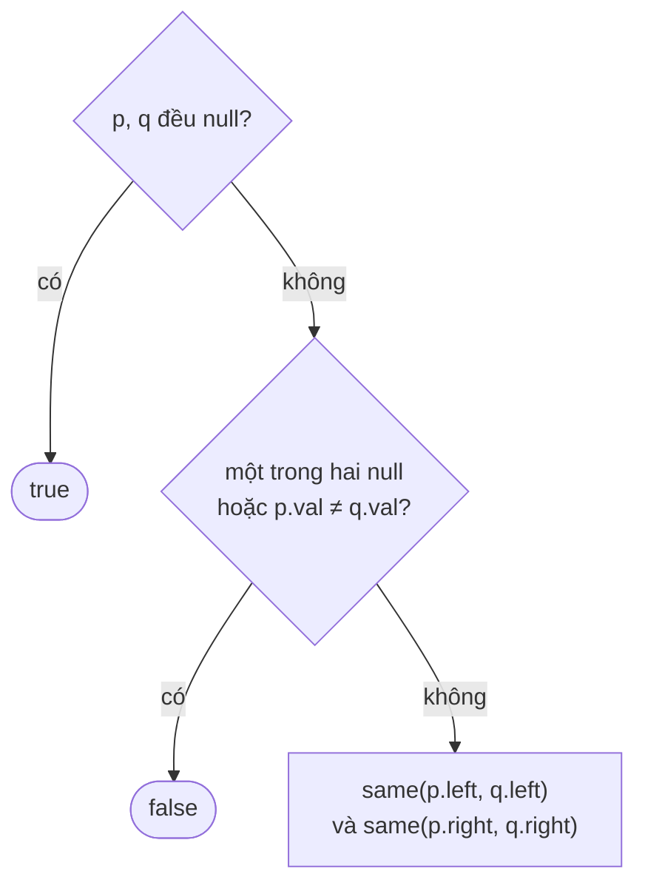

<!-- approaches: Recursive · Iterative queue of pairs -->
# 100. Same Tree

**Easy** · Tree · Depth-First Search · Breadth-First Search · Binary Tree · [LeetCode ↗](https://leetcode.com/problems/same-tree/) · Code: [SameTree.java](SameTree.java) · Tests: [SameTreeTest.java](SameTreeTest.java)

## Đề bài

Hai cây nhị phân có **giống hệt** nhau (cùng hình dạng, cùng giá trị) không?

```
  1       1
 /         \       -> false (cùng giá trị, khác hình dạng)
2           2
```

## Ý tưởng

> Hai cây giống nhau ⇔ **gốc** bằng nhau **và** hai cây con trái giống nhau **và** hai cây con phải giống nhau.



## Cách 1 — Đệ quy `O(n) · O(h)` ⭐

`if (p == null || q == null) return p == q;` — một dòng xử lý cả ba trường hợp có `null`.

## Cách 2 — Stack các cặp node

Đẩy cặp `(p, q)`, lấy ra so sánh, rồi đẩy hai cặp con. Thứ tự duyệt không quan trọng.

## Bẫy & lưu ý

- So sánh **chuỗi duyệt inorder** là **sai**: hai cây khác hình dạng có thể cho cùng chuỗi inorder. Nếu muốn so bằng chuỗi thì phải **ghi cả `null`** (như test làm với `TreeNode.toList`).

## Bài liên quan

101 Symmetric Tree · 572 Subtree of Another Tree · 226 Invert Binary Tree · 951 Flip Equivalent Binary Trees.
