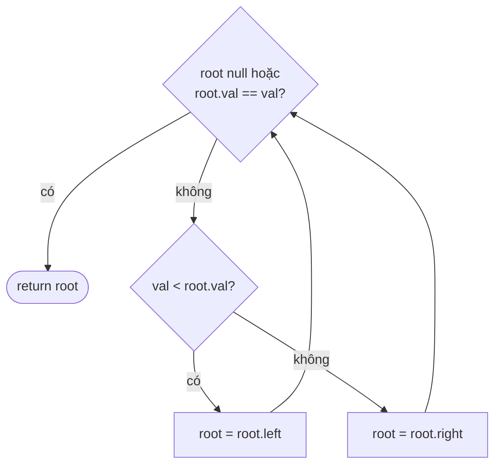

<!-- approaches: Recursive · Iterative -->
# 700. Search in a Binary Search Tree

**Easy** · Tree · Binary Search Tree · Binary Tree · [LeetCode ↗](https://leetcode.com/problems/search-in-a-binary-search-tree/) · Code: [SearchInABinarySearchTree.java](SearchInABinarySearchTree.java) · Tests: [SearchInABinarySearchTreeTest.java](SearchInABinarySearchTreeTest.java)

## Đề bài

Tìm node có giá trị `val` trong BST và trả về cây con gốc tại đó (không có → `null`).

```
        4
       / \
      2   7        val = 2  ->  [2,1,3]
     / \
    1   3
```

## Ý tưởng

> Tìm kiếm nhị phân trên cây: mỗi bước so sánh loại bỏ **một nửa** (một cây con).



## Cách 1 — Đệ quy `O(h)` · stack `O(h)`

## Cách 2 — Vòng lặp `O(h)` · `O(1)` ⭐

Chỉ đi theo **một nhánh** nên không cần stack — vòng `while` là đủ.

## Độ phức tạp

`h` là chiều cao: cây cân bằng `O(log n)`, cây lệch `O(n)`.

## Bài liên quan

701 Insert into a BST · 450 Delete Node in a BST · 235 Lowest Common Ancestor of a BST · 938 Range Sum of BST.
