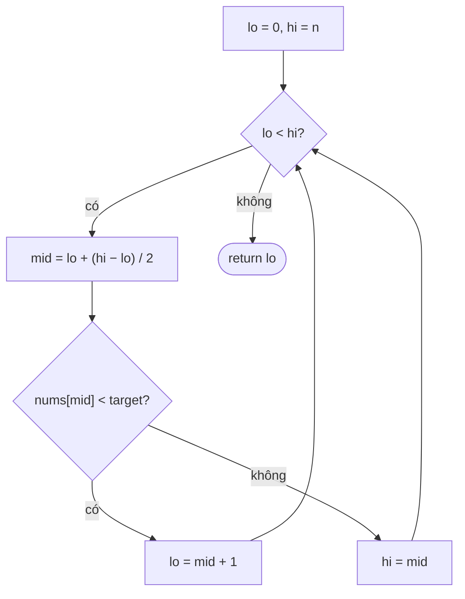

<!-- approaches: Linear scan · Binary search (lower bound) · Arrays.binarySearch -->
# 35. Search Insert Position

**Easy** · Array · Binary Search · [LeetCode ↗](https://leetcode.com/problems/search-insert-position/) · Code: [SearchInsertPosition.java](SearchInsertPosition.java) · Tests: [SearchInsertPositionTest.java](SearchInsertPositionTest.java)

## Đề bài

Mảng đã sắp xếp, các phần tử khác nhau. Trả về vị trí của `target`, hoặc vị trí **nên chèn** nếu không có. Yêu cầu `O(log n)`.

```
[1,3,5,6], 5 -> 2      [1,3,5,6], 2 -> 1      [1,3,5,6], 7 -> 4
```

## Ý tưởng

> Cả hai trường hợp đều là một câu hỏi: **chỉ số đầu tiên có giá trị ≥ target** (gọi là *lower bound*).
> Mảng chia làm hai phần `[< target | ≥ target]` → tìm ranh giới bằng **tìm kiếm nhị phân**.

```
 nums:   1   3 | 5   6        target = 4
        < 4 < 4 | ≥4  ≥4
                ^ lo = 2
```

## Cách 1 — Duyệt tuyến tính `O(n)`

Đi tới phần tử đầu tiên `≥ target`. Đúng, nhưng không đạt yêu cầu.

## Cách 2 — Tìm kiếm nhị phân lower bound `O(log n)` ⭐

Khoảng nửa mở `[lo, hi)` với `hi = n` (đáp án có thể là `n` — chèn cuối).



`[1,3,5,6], target = 2`:

| lo | hi | mid | nums[mid] | hành động |
|---|---|---|---|---|
| 0 | 4 | 2 | 5 | ≥ 2 → hi = 2 |
| 0 | 2 | 1 | 3 | ≥ 2 → hi = 1 |
| 0 | 1 | 0 | 1 | < 2 → lo = 1 |
| 1 | 1 | | | dừng → **1** |

## Cách 3 — `Arrays.binarySearch`

Không tìm thấy thì trả về `−(điểm chèn) − 1` → `−i − 1`. Nên biết, nhưng phỏng vấn sẽ yêu cầu tự viết.

## Bẫy & lưu ý

- `mid = lo + (hi − lo) / 2` tránh tràn số khi `lo + hi` vượt `int`.
- Khuôn `[lo, hi)` + `lo < hi` + `hi = mid` **không bao giờ lặp vô hạn** — học thuộc khuôn này cho mọi bài "tìm ranh giới".

## Bài liên quan

704 Binary Search · 34 Find First and Last Position · 278 First Bad Version · 69 Sqrt(x).
