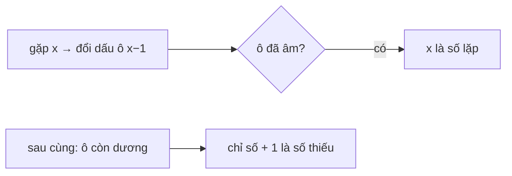

<!-- approaches: Count occurrences · Sum and sum of squares · Mark by negation -->
# 645. Set Mismatch

**Easy** · Array · Hash Table · Bit Manipulation · Sorting · [LeetCode ↗](https://leetcode.com/problems/set-mismatch/) · Code: [SetMismatch.java](SetMismatch.java) · Tests: [SetMismatchTest.java](SetMismatchTest.java)

## Đề bài

Mảng lẽ ra chứa `1…n` mỗi số một lần, nhưng một số bị **lặp** và thay mất một số khác. Trả về `[số lặp, số thiếu]`.

```
[1,2,2,4] -> [2,3]
```

## Ý tưởng

> Kết hợp hai bài: **268 Missing Number** (tìm số thiếu) và **287 Find the Duplicate** (tìm số lặp). Giá trị trong `1…n` → dùng chính mảng làm bảng đánh dấu.



## Cách 1 — Đếm `O(n)` bộ nhớ

## Cách 2 — Toán: tổng và tổng bình phương

- `dup − miss = Σx − n(n+1)/2`
- `dup² − miss² = Σx² − n(n+1)(2n+1)/6` → chia cho hiệu được `dup + miss`.
Giải hệ hai phương trình. `O(1)` bộ nhớ; dùng `long` cho tổng bình phương.

## Cách 3 — Đánh dấu bằng dấu âm `O(1)` ⭐

## Bài liên quan

268 Missing Number · 287 Find the Duplicate Number · 448 Find All Numbers Disappeared · 41 First Missing Positive.
