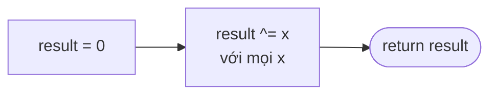

<!-- approaches: Hash set toggle · Math (2·sum distinct − sum) · XOR -->
# 136. Single Number

**Easy** · Array · Bit Manipulation · [LeetCode ↗](https://leetcode.com/problems/single-number/) · Code: [SingleNumber.java](SingleNumber.java) · Tests: [SingleNumberTest.java](SingleNumberTest.java)

## Đề bài

Mọi phần tử xuất hiện **hai lần**, trừ đúng một phần tử. Tìm nó trong `O(n)` thời gian và `O(1)` bộ nhớ.

```
[4,1,2,1,2] -> 4
```

## Ý tưởng

> **XOR** có ba tính chất: `a ^ a = 0`, `a ^ 0 = a`, và có giao hoán / kết hợp.
> XOR tất cả lại → các cặp tự triệt tiêu, chỉ còn phần tử lẻ loi.

```
4 ^ 1 ^ 2 ^ 1 ^ 2  =  4 ^ (1 ^ 1) ^ (2 ^ 2)  =  4 ^ 0 ^ 0  =  4
```

Nhìn theo từng bit: mỗi bit của kết quả = bit đó xuất hiện **lẻ** lần.

| số | bit 2 | bit 1 | bit 0 |
|---|---|---|---|
| 4 | 1 | 0 | 0 |
| 1 | 0 | 0 | 1 |
| 2 | 0 | 1 | 0 |
| 1 | 0 | 0 | 1 |
| 2 | 0 | 1 | 0 |
| **XOR** | **1** | **0** | **0** → 4 |

## Cách 1 — HashSet bật/tắt `O(n) · O(n)`

Gặp lần đầu thì thêm, lần hai thì xoá. Cuối cùng set chỉ còn một phần tử.

## Cách 2 — Toán `O(n) · O(n)`

`2 · (tổng các giá trị khác nhau) − (tổng tất cả) = phần tử lẻ`. Dùng `long` để không tràn.

## Cách 3 — XOR `O(n) · O(1)` ⭐



## Bẫy & lưu ý

- Số âm vẫn đúng với XOR (làm việc trên bit bù hai).
- Biến thể: mọi số xuất hiện **ba** lần (137) → đếm từng bit `mod 3`; **hai** số lẻ loi (260) → tách nhóm theo một bit khác nhau.

## Bài liên quan

137 Single Number II · 260 Single Number III · 268 Missing Number (cũng giải bằng XOR).
