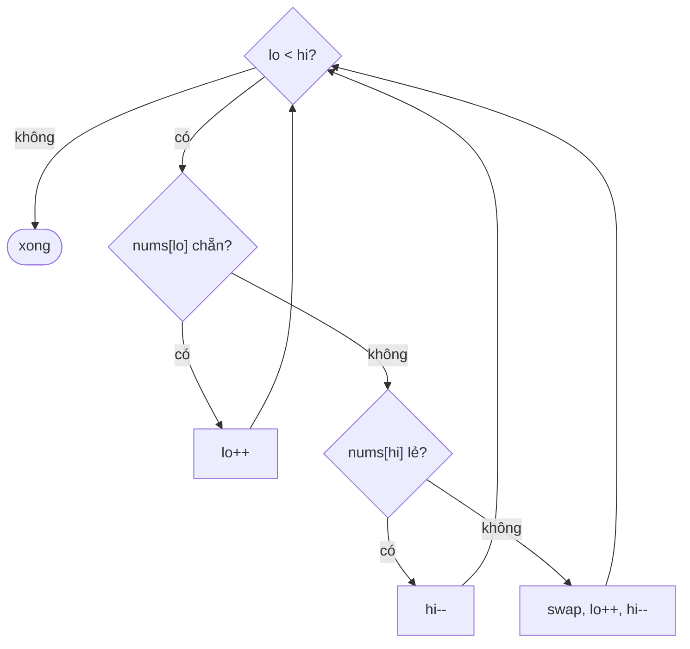

<!-- approaches: Two passes · Two pointers in place · Stable write pointer -->
# 905. Sort Array By Parity

**Easy** · Array · Two Pointers · Sorting · [LeetCode ↗](https://leetcode.com/problems/sort-array-by-parity/) · Code: [SortArrayByParity.java](SortArrayByParity.java) · Tests: [SortArrayByParityTest.java](SortArrayByParityTest.java)

## Đề bài

Đưa mọi số **chẵn** lên trước, số **lẻ** ra sau. Thứ tự bên trong mỗi nhóm tuỳ ý.

```
[3,1,2,4] -> [2,4,3,1]  (hoặc [4,2,3,1], …)
```

## Ý tưởng

> Đây là bước **phân hoạch (partition)** của Quicksort, với điều kiện "chẵn/lẻ" thay cho "nhỏ hơn/lớn hơn pivot".

## Cách 1 — Hai lượt, mảng mới `O(n) · O(n)`

Giữ nguyên thứ tự tương đối (stable).

## Cách 2 — Hai con trỏ từ hai đầu `O(n) · O(1)` ⭐

`lo` tìm số **lẻ** từ trái, `hi` tìm số **chẵn** từ phải, gặp cả hai thì đổi chỗ.



| lo | hi | mảng | hành động |
|---|---|---|---|
| 0 (3 lẻ) | 3 (4 chẵn) | 3 1 2 4 | swap → 4 1 2 3 |
| 1 (1 lẻ) | 2 (2 chẵn) | 4 1 2 3 | swap → 4 2 1 3 |

Ít phép hoán đổi nhất.

## Cách 3 — Con trỏ ghi (kiểu Lomuto) `O(n) · O(1)`

Giống 283 Move Zeroes: mỗi số chẵn đổi về vị trí `write`. Giữ thứ tự các số chẵn.

## Bài liên quan

283 Move Zeroes · 922 Sort Array By Parity II · 75 Sort Colors (phân hoạch 3 nhóm).
