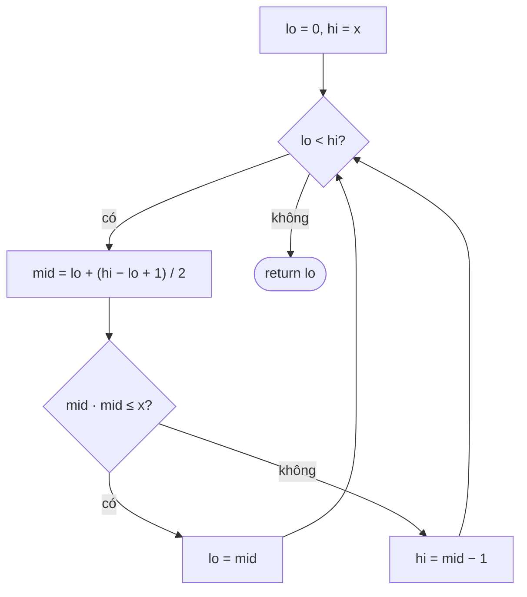

<!-- approaches: Linear · Binary search · Newton's method -->
# 69. Sqrt(x)

**Easy** · Math · Binary Search · [LeetCode ↗](https://leetcode.com/problems/sqrtx/) · Code: [SqrtX.java](SqrtX.java) · Tests: [SqrtXTest.java](SqrtXTest.java)

## Đề bài

Tính `⌊√x⌋` mà không dùng hàm `sqrt` / `pow` có sẵn.

```
4 -> 2      8 -> 2  (√8 = 2.83)
```

## Ý tưởng

> Tìm **số `m` lớn nhất** sao cho `m² ≤ x`. Hàm `m²` tăng dần nên điều kiện `m² ≤ x` có dạng
> `[đúng, đúng, …, đúng, sai, sai, …]` → **tìm kiếm nhị phân trên đáp án**.

```
m:      0  1  2 | 3  4  5  6  7  8      (x = 8)
m²≤8?   ✓  ✓  ✓ | ✗  ✗  ✗  ✗  ✗  ✗
              ^ đáp án = 2
```

## Cách 1 — Thử lần lượt `O(√x)`

Tăng `i` khi `(i+1)² ≤ x`. Với `x ≈ 2·10⁹` là ~46 000 vòng — vẫn chạy được nhưng không phải điều người phỏng vấn muốn.

## Cách 2 — Tìm kiếm nhị phân `O(log x)` ⭐

Tìm **phần tử đúng cuối cùng** → làm tròn `mid` **lên** để `lo = mid` luôn tiến.



## Cách 3 — Phương pháp Newton `O(log log x)`

Tiếp tuyến của `f(r) = r² − x` cho công thức `r ← (r + x/r) / 2`. Bắt đầu từ `r = x`, giảm dần tới khi `r² ≤ x`. Hội tụ cực nhanh (~ 20 vòng cho `int`).

| vòng | r (x = 8) |
|---|---|
| 0 | 8 |
| 1 | (8 + 1) / 2 = 4 |
| 2 | (4 + 2) / 2 = 3 |
| 3 | (3 + 2) / 2 = 2 → 2² ≤ 8 dừng |

## Bẫy & lưu ý

- `mid * mid` tràn `int` khi `mid > 46340` → dùng `long`.
- Tìm "đúng cuối cùng" mà làm tròn `mid` xuống → `lo = mid` không tiến → **lặp vô hạn** khi `hi = lo + 1`.
- `x = 0` và `x = 1` là đáp án chính nó.

## Bài liên quan

367 Valid Perfect Square · 50 Pow(x, n) · 35 Search Insert Position · 875 Koko Eating Bananas (nhị phân trên đáp án).
