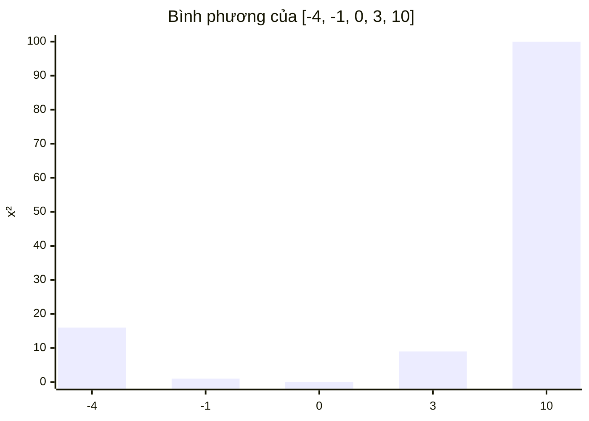

<!-- approaches: Square + sort · Two pointers from the ends -->
# 977. Squares of a Sorted Array

**Easy** · Array · Two Pointers · Sorting · [LeetCode ↗](https://leetcode.com/problems/squares-of-a-sorted-array/) · Code: [SquaresOfASortedArray.java](SquaresOfASortedArray.java) · Tests: [SquaresOfASortedArrayTest.java](SquaresOfASortedArrayTest.java)

## Đề bài

Mảng đã sắp xếp tăng (có thể có số âm). Trả về bình phương các phần tử, cũng **sắp xếp tăng**. Follow-up: `O(n)`.

```
[-4,-1,0,3,10] -> [0,1,9,16,100]
```

## Ý tưởng

> Bình phương của dãy tăng có hình **chữ V**: giảm dần ở phần âm, tăng dần ở phần dương. Phần tử **lớn nhất** luôn nằm ở **một trong hai đầu**.
> → Hai con trỏ ở hai đầu, so trị tuyệt đối, ghi số lớn hơn vào **cuối** mảng kết quả.



## Cách 1 — Bình phương rồi sắp xếp `O(n log n)`

## Cách 2 — Hai con trỏ `O(n)` ⭐

| lo | hi | so sánh | ghi vào | out |
|---|---|---|---|---|
| −4 | 10 | 4 < 10 | k=4 | _ _ _ _ 100 |
| −4 | 3 | 4 > 3 | k=3 | _ _ _ 16 100 |
| −1 | 3 | 1 < 3 | k=2 | _ _ 9 16 100 |
| −1 | 0 | 1 > 0 | k=1 | _ 1 9 16 100 |
| 0 | 0 | | k=0 | 0 1 9 16 100 |

## Bẫy & lưu ý

- Điền từ **cuối** lên: biết chắc số lớn nhất, không biết chắc số nhỏ nhất (nằm đâu đó ở giữa).

## Bài liên quan

88 Merge Sorted Array (cũng điền từ cuối) · 360 Sort Transformed Array · 167 Two Sum II.
