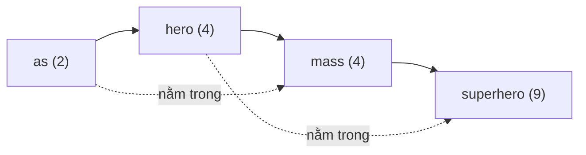

<!-- approaches: All pairs · Sort by length · Joined text -->
# 1408. String Matching in an Array

**Easy** · Array · String · String Matching · [LeetCode ↗](https://leetcode.com/problems/string-matching-in-an-array/) · Code: [StringMatchingInAnArray.java](StringMatchingInAnArray.java) · Tests: [StringMatchingInAnArrayTest.java](StringMatchingInAnArrayTest.java)

## Đề bài

Các từ đều khác nhau. Trả về mọi từ là **chuỗi con** của một từ khác.

```
["mass","as","hero","superhero"] -> ["as","hero"]
```

## Ý tưởng

> Một từ chỉ có thể nằm trong từ **dài hơn** nó. Ràng buộc nhỏ (≤ 100 từ, mỗi từ ≤ 30 ký tự) nên so từng cặp là đủ — điểm cộng là cắt bớt việc thừa.

## Cách 1 — So mọi cặp ⭐ (đơn giản, đủ nhanh)

`other.contains(w)` với mọi `other ≠ w`; tìm thấy một lần là `break`.

## Cách 2 — Sắp xếp theo độ dài

Sau khi sắp xếp, `w` chỉ cần so với các từ **bên phải** (dài hơn hoặc bằng).



## Cách 3 — Nối tất cả thành một chuỗi

`"mass|as|hero|superhero"`: `w` là chuỗi con của từ khác **khi và chỉ khi** nó xuất hiện **≥ 2 lần** trong chuỗi nối (một lần là chính nó). Kiểm tra bằng `indexOf(w) != lastIndexOf(w)`.
Dấu `|` ngăn việc khớp "vắt" qua hai từ (ví dụ `"sa"` từ `"mass" + "as"`).

## Bẫy & lưu ý

- Đề nói các từ **khác nhau**, nên cách 3 không bị đếm nhầm do từ trùng.
- Một từ có thể nằm trong nhiều từ khác — chỉ thêm vào kết quả **một lần** (`break`).
- Dữ liệu lớn hơn → dựng **Aho–Corasick** hoặc suffix automaton.

## Bài liên quan

28 Find the Index of the First Occurrence in a String · 796 Rotate String · 1023 Camelcase Matching.
