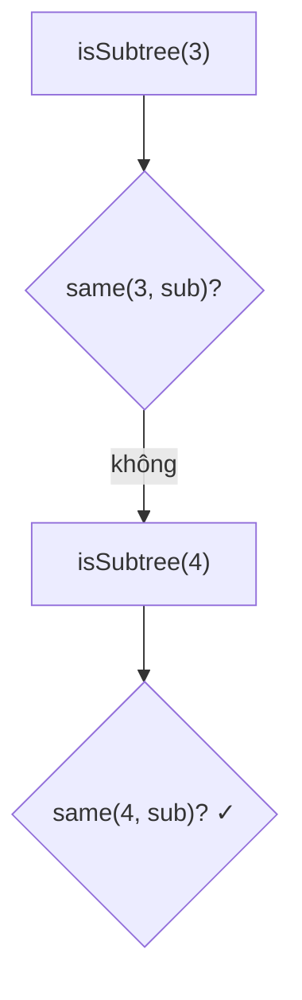

<!-- approaches: Same-tree check at every node · Serialize and substring search -->
# 572. Subtree of Another Tree

**Easy** · Tree · Depth-First Search · String Matching · Binary Tree · [LeetCode ↗](https://leetcode.com/problems/subtree-of-another-tree/) · Code: [SubtreeOfAnotherTree.java](SubtreeOfAnotherTree.java) · Tests: [SubtreeOfAnotherTreeTest.java](SubtreeOfAnotherTreeTest.java)

## Đề bài

`subRoot` có phải **cây con** của `root` không — tức là có một node của `root` mà nó cùng **toàn bộ** con cháu giống hệt `subRoot`?

```
     3
    / \          subRoot:   4
   4   5                   / \     -> true
  / \                     1   2
 1   2
```

## Ý tưởng

> Thử **mọi node** của `root` làm gốc, kiểm tra bằng bài **100 Same Tree**.



## Cách 1 — Same Tree tại mọi node `O(m·n)` ⭐

## Cách 2 — Tuần tự hoá + tìm chuỗi con

Preorder có **đánh dấu null** xác định duy nhất một cây (bài 297), nên "cây con" ⇔ "chuỗi con". Cần dấu phân cách **trước** mỗi giá trị: không có thì cây `[2]` khớp nhầm bên trong `[12]`. Với KMP đạt `O(m + n)`.

## Bài liên quan

100 Same Tree · 297 Serialize and Deserialize Binary Tree · 1367 Linked List in Binary Tree · 652 Find Duplicate Subtrees.
