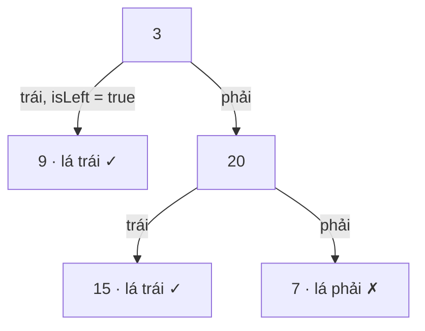

<!-- approaches: Recursive with is-left flag · Iterative stack -->
# 404. Sum of Left Leaves

**Easy** · Tree · Depth-First Search · Breadth-First Search · Binary Tree · [LeetCode ↗](https://leetcode.com/problems/sum-of-left-leaves/) · Code: [SumOfLeftLeaves.java](SumOfLeftLeaves.java) · Tests: [SumOfLeftLeavesTest.java](SumOfLeftLeavesTest.java)

## Đề bài

Tổng giá trị các **lá trái** (lá là con trái của cha nó).

```
    3
   / \
  9  20        -> 9 + 15 = 24
    /  \
   15   7
```

## Ý tưởng

> Một node tự nó không biết mình là con trái hay phải — thông tin đó nằm ở **cha**. Hai cách: **truyền xuống** cờ `isLeft`, hoặc cha **nhìn xuống** con trái của mình.



## Cách 1 — Đệ quy với cờ `isLeft` ⭐

## Cách 2 — Stack, cha kiểm tra con trái

Khi lấy một node ra, nếu con trái là lá thì cộng luôn, không cần đẩy vào stack.

## Bẫy & lưu ý

- Gốc cây chỉ có một node **không** phải lá trái (không có cha) → 0.

## Bài liên quan

112 Path Sum · 257 Binary Tree Paths · 513 Find Bottom Left Tree Value.
