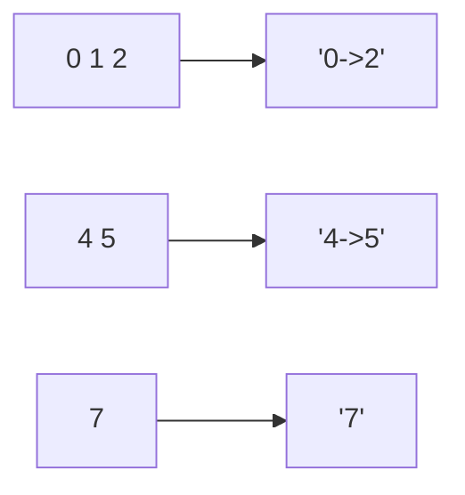

<!-- approaches: Two pointers over runs -->
# 228. Summary Ranges

**Easy** · Array · [LeetCode ↗](https://leetcode.com/problems/summary-ranges/) · Code: [SummaryRanges.java](SummaryRanges.java) · Tests: [SummaryRangesTest.java](SummaryRangesTest.java)

## Đề bài

Mảng tăng dần, các số khác nhau. Gom thành ít khoảng nhất: dãy liên tiếp viết `"a->b"`, số đứng một mình viết `"a"`.

```
[0,1,2,4,5,7] -> ["0->2", "4->5", "7"]
```

## Ý tưởng

> Hai con trỏ: `i` là đầu một dãy, `j` chạy tới khi số kế tiếp **không** còn bằng `nums[j] + 1`.



## Lời giải — Hai con trỏ `O(n)` ⭐

So sánh bằng `long`: `nums[j] + 1` tràn khi `nums[j] = Integer.MAX_VALUE` (test có ca này).

## Bài liên quan

163 Missing Ranges · 352 Data Stream as Disjoint Intervals · 56 Merge Intervals.
