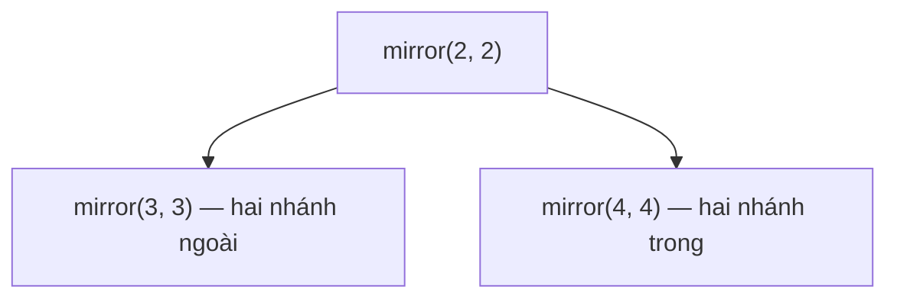

<!-- approaches: Recursive mirror check · Iterative queue of pairs -->
# 101. Symmetric Tree

**Easy** · Tree · Depth-First Search · Breadth-First Search · Binary Tree · [LeetCode ↗](https://leetcode.com/problems/symmetric-tree/) · Code: [SymmetricTree.java](SymmetricTree.java) · Tests: [SymmetricTreeTest.java](SymmetricTreeTest.java)

## Đề bài

Cây nhị phân có **đối xứng gương** qua trục giữa không?

```
      1                 1
    /   \             /   \
   2     2           2     2
  / \   / \           \     \
 3   4 4   3           3     3
   true                 false
```

## Ý tưởng

> Cây đối xứng ⇔ cây con trái là **ảnh gương** của cây con phải. Hai cây `a`, `b` là ảnh gương khi:
> gốc bằng nhau, `a.left` gương với `b.right`, và `a.right` gương với `b.left` — **ngoài với ngoài, trong với trong**.



## Cách 1 — Đệ quy ⭐

Giống 100 Same Tree, chỉ khác là so **chéo** (`left` với `right`).

## Cách 2 — Hàng đợi các cặp

Mỗi lần lấy ra hai node phải là ảnh gương; đẩy vào hai cặp mới theo thứ tự chéo. Dùng `LinkedList` vì `ArrayDeque` không nhận `null`.

## Bài liên quan

100 Same Tree · 226 Invert Binary Tree (cây đối xứng ⇔ bằng chính nó sau khi lật).
