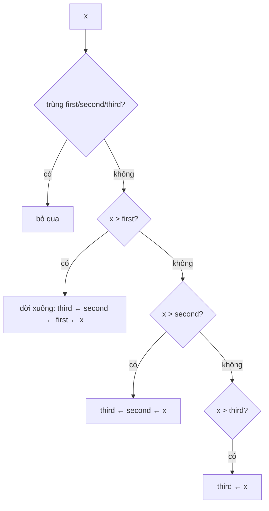

<!-- approaches: Three variables · TreeSet of size 3 · Sort distinct -->
# 414. Third Maximum Number

**Easy** · Array · Sorting · [LeetCode ↗](https://leetcode.com/problems/third-maximum-number/) · Code: [ThirdMaximumNumber.java](ThirdMaximumNumber.java) · Tests: [ThirdMaximumNumberTest.java](ThirdMaximumNumberTest.java)

## Đề bài

Trả về số lớn **thứ ba** trong các giá trị **khác nhau**; nếu không có thì trả về số lớn nhất.

```
[2,2,3,1] -> 1   (các giá trị khác nhau: 3, 2, 1)
[1,2]     -> 2
```

## Ý tưởng

> Một lượt, giữ ba giá trị lớn nhất **khác nhau** `first > second > third`, bỏ qua số trùng.



## Cách 1 — Ba biến `O(n)` ⭐

**Bẫy:** khởi tạo bằng `Integer.MIN_VALUE` là **sai** khi chính `MIN_VALUE` có trong mảng (không phân biệt được "chưa có" với "có giá trị nhỏ nhất"). Dùng `Long` có thể `null` (hoặc `Long.MIN_VALUE`).

## Cách 2 — TreeSet giữ 3 phần tử

`TreeSet` tự bỏ trùng và giữ thứ tự; vượt 3 phần tử thì bỏ phần tử nhỏ nhất.

## Bài liên quan

215 Kth Largest Element in an Array · 703 Kth Largest Element in a Stream · 628 Maximum Product of Three Numbers.
