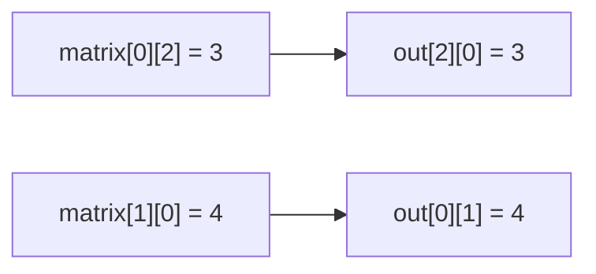

<!-- approaches: New matrix · Streams -->
# 867. Transpose Matrix

**Easy** · Array · Matrix · Simulation · [LeetCode ↗](https://leetcode.com/problems/transpose-matrix/) · Code: [TransposeMatrix.java](TransposeMatrix.java) · Tests: [TransposeMatrixTest.java](TransposeMatrixTest.java)

## Đề bài

Ma trận chuyển vị: hàng thành cột (lật qua đường chéo chính).

```
1 2 3        1 4
4 5 6   ->   2 5
             3 6
```

## Ý tưởng

> Phần tử ở `(i, j)` chuyển tới `(j, i)`. Ma trận `m × n` thành `n × m` — nên (trừ ma trận vuông) phải tạo **mảng mới**.



## Cách 1 — Hai vòng lặp `O(m·n)` ⭐

## Cách 2 — Stream

Cột `j` của đầu vào là hàng `j` của đầu ra.

## Bẫy & lưu ý

- Ma trận **vuông** có thể chuyển vị tại chỗ: hoán đổi `(i, j)` với `(j, i)` chỉ cho `j > i` (nếu đổi hết sẽ đổi hai lần — về như cũ). Đây là bước 1 của bài 48 Rotate Image.

## Bài liên quan

48 Rotate Image · 54 Spiral Matrix · 566 Reshape the Matrix.
