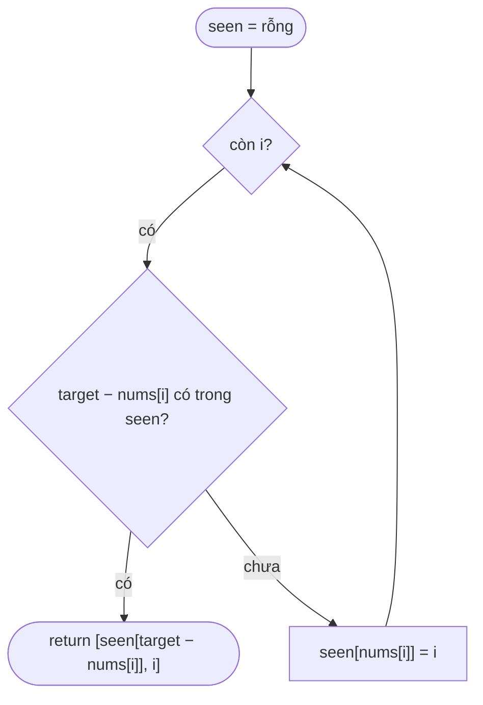
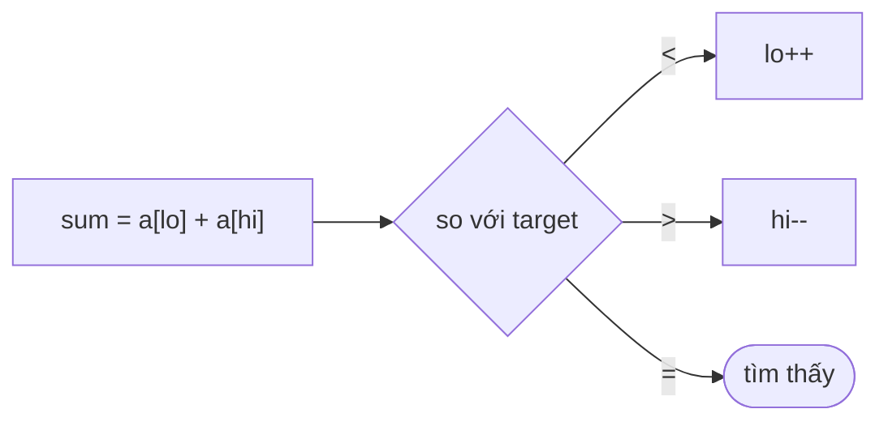

<!-- approaches: Brute force · Hash map · Sort + two pointers -->
# 1. Two Sum

**Easy** · Array · Hash Table · [LeetCode ↗](https://leetcode.com/problems/two-sum/) · Code: [TwoSum.java](TwoSum.java) · Tests: [TwoSumTest.java](TwoSumTest.java)

## Đề bài

Cho mảng `nums` và `target`, trả về **chỉ số** của hai phần tử có tổng bằng `target` (luôn có đúng một đáp án, không dùng một phần tử hai lần).

```
nums = [2, 7, 11, 15], target = 9  ->  [0, 1]     (2 + 7 = 9)
nums = [3, 2, 4],      target = 6  ->  [1, 2]
```

## Ý tưởng

> Với mỗi `x`, câu hỏi thật sự là: **"`target − x` đã xuất hiện chưa, ở vị trí nào?"** — một câu hỏi tra cứu, nên dùng HashMap.

## Cách 1 — Vét cạn `O(n²) · O(1)`

Thử mọi cặp `(i, j)` với `i < j`. Đúng nhưng chậm với n = 10⁴.

## Cách 2 — HashMap một lượt `O(n) · O(n)` ⭐

Duyệt từ trái sang phải; trước khi lưu `nums[i]`, hỏi map xem "phần bù" `target − nums[i]` đã có chưa.



Chạy tay `nums = [2, 7, 11, 15], target = 9`:

| i | nums[i] | cần tìm | seen trước | kết quả |
|---|---|---|---|---|
| 0 | 2 | 7 | {} | lưu 2→0 |
| 1 | 7 | 2 | {2→0} | **tìm thấy → [0, 1]** |

> Vì sao lưu **sau** khi kiểm tra? Để không ghép một phần tử với chính nó (`nums = [3, …], target = 6`).

## Cách 3 — Sắp xếp + hai con trỏ `O(n log n) · O(n)`

Sắp xếp **chỉ số** theo giá trị, rồi hai con trỏ từ hai đầu: tổng nhỏ quá → tăng `lo`, lớn quá → giảm `hi`.
Nếu mảng **đã sắp xếp sẵn** (bài 167) thì cách này chỉ tốn `O(1)` bộ nhớ.



## So sánh

| Cách | Thời gian | Bộ nhớ | Khi nào dùng |
|---|---|---|---|
| Vét cạn | O(n²) | O(1) | n rất nhỏ / làm chuẩn để test |
| HashMap | **O(n)** | O(n) | Mặc định khi phỏng vấn |
| Sort + 2 con trỏ | O(n log n) | O(n) | Mảng đã sắp xếp, hoặc cần mọi cặp (3Sum) |

## Bẫy & lưu ý

- Trả về **chỉ số**, không phải giá trị — sắp xếp làm mất chỉ số gốc nên phải sắp xếp mảng chỉ số.
- Giá trị trùng (`[3, 3]`): HashMap vẫn đúng vì kiểm tra trước khi ghi đè.
- Số âm không ảnh hưởng gì.

## Bài liên quan

167 Two Sum II (mảng đã sắp xếp) · 15 3Sum · 18 4Sum · 560 Subarray Sum Equals K (cùng ý tưởng "phần bù" trên prefix sum).
