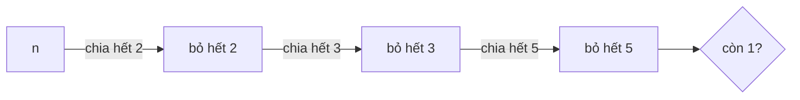

<!-- approaches: Divide out 2, 3 and 5 -->
# 263. Ugly Number

**Easy** · Math · [LeetCode ↗](https://leetcode.com/problems/ugly-number/) · Code: [UglyNumber.java](UglyNumber.java) · Tests: [UglyNumberTest.java](UglyNumberTest.java)

## Đề bài

**Số xấu** là số nguyên dương chỉ có thừa số nguyên tố 2, 3, 5. `n` có xấu không?

```
6 = 2·3 -> true      14 = 2·7 -> false      1 -> true (không có thừa số nào)
```

## Ý tưởng

> Chia hết cho 2 thì chia, rồi tới 3, rồi tới 5. Nếu `n` chỉ gồm các thừa số đó thì cuối cùng còn lại **đúng 1**.



| n | sau khi bỏ 2 | bỏ 3 | bỏ 5 | kết quả |
|---|---|---|---|---|
| 30 | 15 | 5 | 1 | ✓ |
| 14 | 7 | 7 | 7 | ✗ |

## Lời giải `O(log n)` ⭐

**Bẫy:** `n ≤ 0` → `false` (`0 % p == 0` sẽ lặp vô hạn).

## Bài liên quan

264 Ugly Number II (sinh số xấu thứ n — ba con trỏ) · 1201 Ugly Number III · 313 Super Ugly Number.
