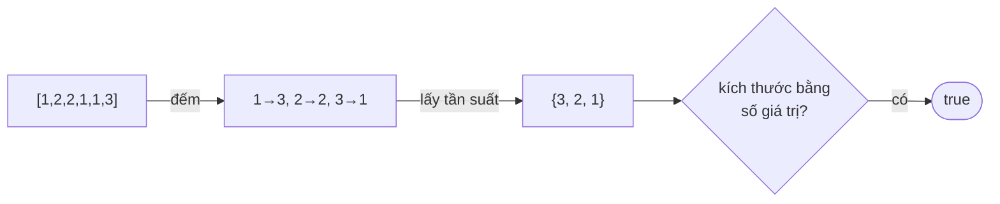

<!-- approaches: Hash map + set · Counting array + seen table -->
# 1207. Unique Number of Occurrences

**Easy** · Array · Hash Table · [LeetCode ↗](https://leetcode.com/problems/unique-number-of-occurrences/) · Code: [UniqueNumberOfOccurrences.java](UniqueNumberOfOccurrences.java) · Tests: [UniqueNumberOfOccurrencesTest.java](UniqueNumberOfOccurrencesTest.java)

## Đề bài

Số lần xuất hiện của mỗi giá trị có **đôi một khác nhau** không?

```
[1,2,2,1,1,3] -> true   (1 xuất hiện 3 lần, 2: 2 lần, 3: 1 lần)
[1,2]         -> false  (cả hai đều 1 lần)
```

## Ý tưởng

> Hai bước: **đếm** tần suất, rồi kiểm tra các tần suất **không trùng** (bài Contains Duplicate trên tập tần suất).



## Cách 1 — HashMap + HashSet `O(n)` ⭐

`new HashSet<>(count.values()).size() == count.size()`.

## Cách 2 — Mảng đếm + bảng "đã dùng"

Giá trị trong `[−1000, 1000]` → mảng 2001 ô (cộng 1000 để chỉ số không âm). Tần suất tối đa là `n` → mảng boolean `n + 1` ô.

## Bài liên quan

217 Contains Duplicate · 1647 Minimum Deletions to Make Character Frequencies Unique · 451 Sort Characters By Frequency.
