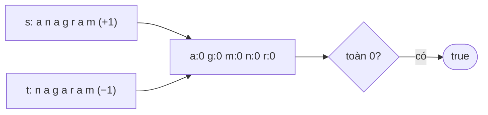

<!-- approaches: Sort · Count array · Hash map (Unicode) -->
# 242. Valid Anagram

**Easy** · Hash Table · String · Sorting · [LeetCode ↗](https://leetcode.com/problems/valid-anagram/) · Code: [ValidAnagram.java](ValidAnagram.java) · Tests: [ValidAnagramTest.java](ValidAnagramTest.java)

## Đề bài

`t` có phải **đảo chữ** (anagram) của `s` không — cùng các chữ cái với cùng số lượng?

```
("anagram", "nagaram") -> true      ("rat", "car") -> false
```

## Ý tưởng

> Hai chuỗi là anagram ⇔ **bảng tần suất** giống nhau. Đếm `+1` cho `s`, `−1` cho `t` trên **cùng một** mảng; cuối cùng mọi ô phải bằng 0.



## Cách 1 — Sắp xếp rồi so sánh `O(n log n)`

## Cách 2 — Mảng đếm 26 ô `O(n) · O(1)` ⭐

Kiểm tra độ dài trước — khác độ dài thì chắc chắn `false`, và nhờ đó có thể đếm hai chuỗi trong **cùng một vòng lặp**.

## Cách 3 — HashMap theo code point (follow-up Unicode)

Ký tự tiếng Việt, emoji… không vừa mảng 26 ô. Emoji còn chiếm **hai** `char` (surrogate pair) → đếm theo `codePoints()` chứ không theo `charAt`.

## Bài liên quan

49 Group Anagrams · 438 Find All Anagrams in a String · 383 Ransom Note · 567 Permutation in String.
