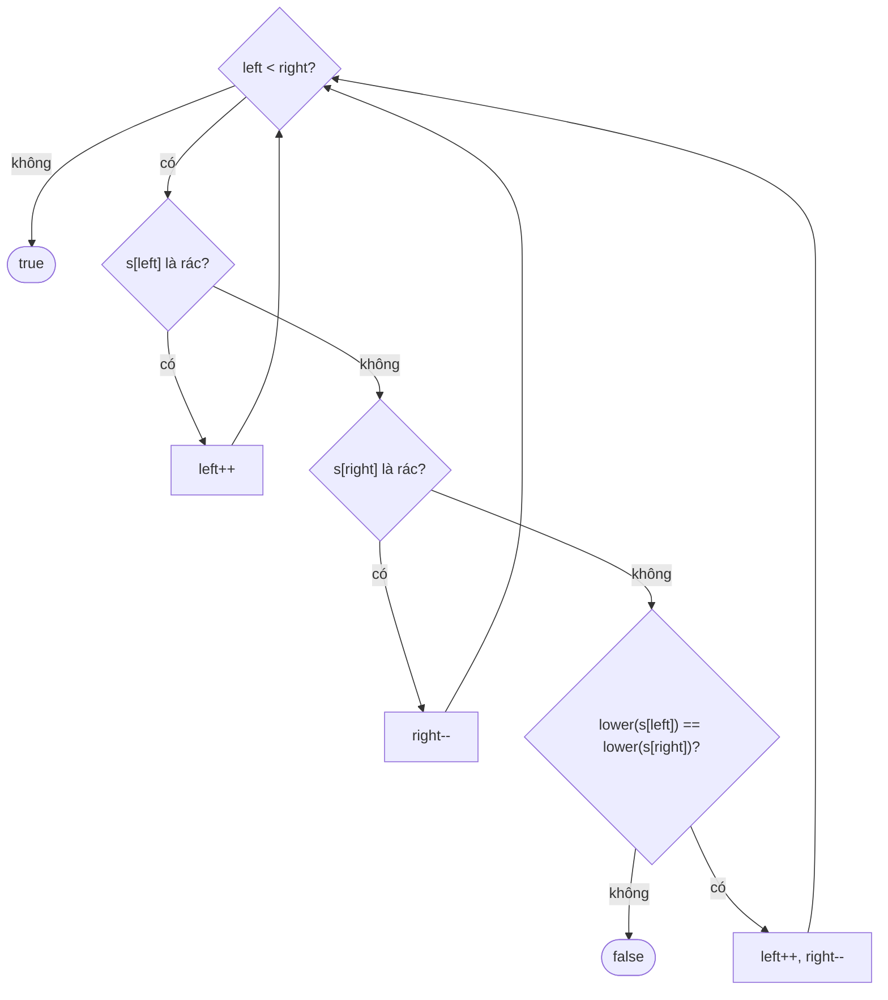

<!-- approaches: Clean + reverse · Two pointers -->
# 125. Valid Palindrome

**Easy** · Two Pointers · String · [LeetCode ↗](https://leetcode.com/problems/valid-palindrome/) · Code: [ValidPalindrome.java](ValidPalindrome.java) · Tests: [ValidPalindromeTest.java](ValidPalindromeTest.java)

## Đề bài

Bỏ mọi ký tự không phải chữ/số, chuyển về chữ thường. Chuỗi còn lại có **đối xứng** không?

```
"A man, a plan, a canal: Panama"  ->  "amanaplanacanalpanama"  -> true
"race a car"                      ->  "raceacar"               -> false
```

## Ý tưởng

> Đối xứng = ký tự thứ `i` từ đầu bằng ký tự thứ `i` từ cuối → **hai con trỏ đi ngược chiều**, bỏ qua ký tự rác ngay trên đường đi.

## Cách 1 — Làm sạch rồi đảo `O(n) · O(n)`

Tạo chuỗi sạch, so với bản đảo ngược. Dễ viết, tốn thêm bộ nhớ.

## Cách 2 — Hai con trỏ `O(n) · O(1)` ⭐



```
"race a car"
 r a c e _ a _ c a r
 ^                 ^   r = r
   ^             ^     a = a
     ^         ^       c = c
       ^     ^         e ≠ a  -> false
```

## Bẫy & lưu ý

- **Chữ số** cũng được giữ lại: `"0P"` → `false`.
- Chuỗi chỉ toàn ký tự rác (`" "`, `".,"`) → `true` (chuỗi rỗng là đối xứng).
- `Character.isLetterOrDigit` / `toLowerCase` thay cho tự viết bảng ASCII.

## Bài liên quan

680 Valid Palindrome II (được xoá tối đa 1 ký tự) · 9 Palindrome Number · 234 Palindrome Linked List · 5 Longest Palindromic Substring.
