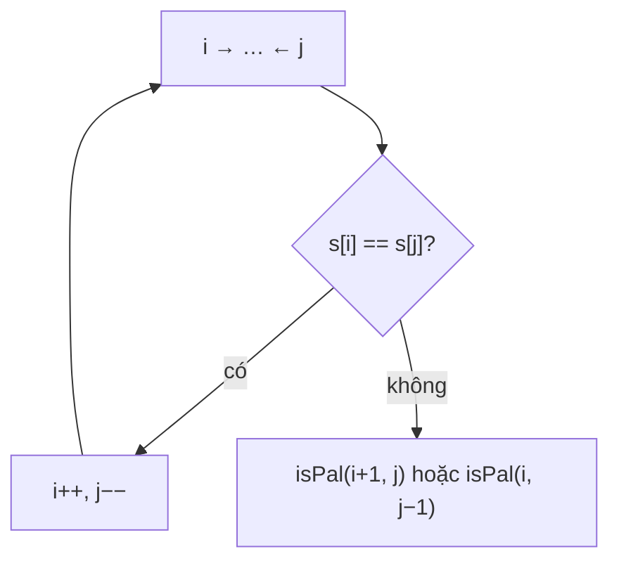

<!-- approaches: Two pointers with one skip · Recursive with deletion budget -->
# 680. Valid Palindrome II

**Easy** · Two Pointers · String · Greedy · [LeetCode ↗](https://leetcode.com/problems/valid-palindrome-ii/) · Code: [ValidPalindromeII.java](ValidPalindromeII.java) · Tests: [ValidPalindromeIITest.java](ValidPalindromeIITest.java)

## Đề bài

Được xoá **tối đa một** ký tự. Chuỗi có thành đối xứng được không?

```
"abca" -> true (xoá 'c' hoặc 'b')      "abc" -> false
```

## Ý tưởng

> Hai con trỏ từ hai đầu như bài 125. Gặp chỗ **lệch đầu tiên** `s[i] ≠ s[j]`: một trong hai ký tự này phải bị xoá. Thử **cả hai** khả năng — phần còn lại `s[i+1..j]` hoặc `s[i..j−1]` phải đối xứng.



`"abca"`: `a = a`, rồi `b ≠ c` → thử `"c"` (bỏ b) → đối xứng ✓.

## Cách 1 — Hai con trỏ, cho phép bỏ một lần `O(n)` ⭐

Chỉ rẽ nhánh **một lần**, mỗi nhánh `O(n)` → tổng `O(n)`.

## Cách 2 — Đệ quy với "ngân sách xoá"

Tổng quát cho "xoá tối đa `k` ký tự". Với `k` lớn thì cần DP (bài 1216 Valid Palindrome III).

## Bài liên quan

125 Valid Palindrome · 1216 Valid Palindrome III · 5 Longest Palindromic Substring.
