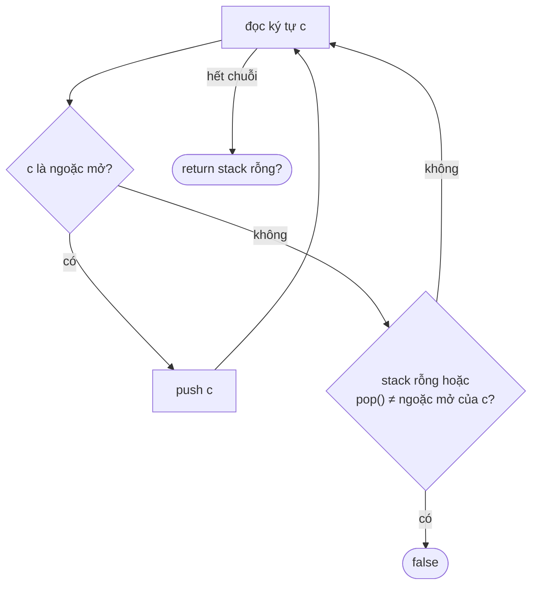

<!-- approaches: Stack · Expected-closer stack · Repeated removal -->
# 20. Valid Parentheses

**Easy** · String · Stack · [LeetCode ↗](https://leetcode.com/problems/valid-parentheses/) · Code: [ValidParentheses.java](ValidParentheses.java) · Tests: [ValidParenthesesTest.java](ValidParenthesesTest.java)

## Đề bài

Chuỗi chỉ gồm `()[]{}`. Hợp lệ khi mỗi ngoặc mở được đóng bởi **đúng loại** và **đúng thứ tự**.

```
"()[]{}" -> true     "(]" -> false     "([)]" -> false     "{[]}" -> true
```

## Ý tưởng

> Ngoặc mở **gần nhất** chưa đóng phải được đóng **trước** — "vào sau ra trước" chính là **stack**.

## Cách 1 — Stack `O(n) · O(n)` ⭐



Chạy tay `"{[]}"` và `"([)]"`:

| ký tự | stack `{[]}` | | ký tự | stack `([)]` |
|---|---|---|---|---|
| `{` | `{` | | `(` | `(` |
| `[` | `{ [` | | `[` | `( [` |
| `]` | `{` (khớp `[`) | | `)` | pop `[` ≠ `(` → **false** |
| `}` | rỗng → **true** | | | |

## Cách 2 — Đẩy ngoặc đóng mong đợi `O(n) · O(n)`

Gặp `(` thì push `)` — "mình đang chờ một dấu `)`". Gặp ngoặc đóng chỉ cần so bằng với đỉnh stack. Thêm mẹo: **độ dài lẻ** → `false` ngay.

## Cách 3 — Xoá cặp liền nhau `O(n²) · O(n)`

Lặp xoá `()`, `[]`, `{}` cho tới khi chuỗi không đổi; hợp lệ khi chuỗi rỗng. Dễ hiểu, dùng làm chuẩn để test, nhưng chậm.

## Bẫy & lưu ý

- Gặp ngoặc đóng khi **stack rỗng** (`"]"`) → `false`, đừng `pop()` trên stack rỗng.
- Hết chuỗi mà stack **còn phần tử** (`"(("`) → `false`.
- Dùng `ArrayDeque` thay cho `Stack` (lớp cũ, đồng bộ hoá không cần thiết).

## Bài liên quan

22 Generate Parentheses · 32 Longest Valid Parentheses (Hard) · 1249 Minimum Remove to Make Valid Parentheses · 150 Evaluate Reverse Polish Notation.
