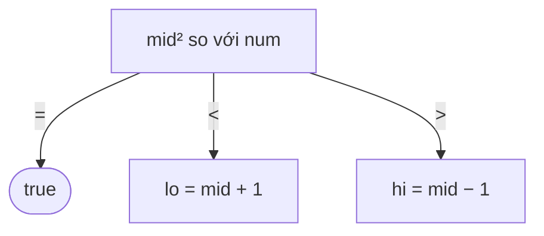

<!-- approaches: Binary search · Newton's method · Sum of odd numbers -->
# 367. Valid Perfect Square

**Easy** · Math · Binary Search · [LeetCode ↗](https://leetcode.com/problems/valid-perfect-square/) · Code: [ValidPerfectSquare.java](ValidPerfectSquare.java) · Tests: [ValidPerfectSquareTest.java](ValidPerfectSquareTest.java)

## Đề bài

`num` có phải số chính phương không? Không dùng `sqrt`.

```
16 -> true      14 -> false
```

## Ý tưởng

> Tìm `m` sao cho `m² = num`. Vì `m²` tăng theo `m` → **tìm kiếm nhị phân** trên `m` (như 69 Sqrt(x)).



## Cách 1 — Tìm kiếm nhị phân `O(log n)` ⭐

`mid * mid` dùng `long` — với `mid` lớn hơn 46 340 thì tràn `int`.

## Cách 2 — Newton

`r ← (r + num/r) / 2` hội tụ rất nhanh về `⌊√num⌋`, rồi kiểm tra `r² == num`.

## Cách 3 — Tổng các số lẻ

`1 + 3 + 5 + … + (2k−1) = k²`. Trừ dần các số lẻ: về đúng 0 ⇔ số chính phương. Đẹp về toán học nhưng `O(√n)`.

| num = 16 | 16 − 1 = 15 | − 3 = 12 | − 5 = 7 | − 7 = **0** ✓ |
|---|---|---|---|---|

## Bài liên quan

69 Sqrt(x) · 279 Perfect Squares · 633 Sum of Square Numbers.
