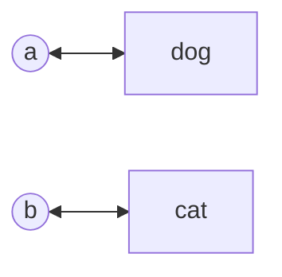

<!-- approaches: Two maps (letter <-> word) · Index-of-first-appearance comparison -->
# 290. Word Pattern

**Easy** · Hash Table · String · [LeetCode ↗](https://leetcode.com/problems/word-pattern/) · Code: [WordPattern.java](WordPattern.java) · Tests: [WordPatternTest.java](WordPatternTest.java)

## Đề bài

Chuỗi từ `s` có theo đúng `pattern` không — mỗi chữ cái ứng với **một** từ và ngược lại (song ánh)?

```
"abba", "dog cat cat dog"  -> true
"abba", "dog dog dog dog"  -> false  (a và b không được cùng là "dog")
```

## Ý tưởng

> Giống 205 Isomorphic Strings, chỉ là bên phải là **từ** thay vì ký tự. Cần kiểm tra **hai chiều**: chữ → từ nhất quán **và** từ → chữ nhất quán.



## Cách 1 — Hai HashMap ⭐

Kiểm tra độ dài trước: số từ phải bằng số chữ cái.

## Cách 2 — So vị trí xuất hiện đầu tiên

Một map chung cho cả chữ cái và từ (khoá `Character` và `String` không bao giờ trùng nhau). Chữ cái thứ `i` và từ thứ `i` phải có **cùng** vị trí xuất hiện đầu tiên.

## Bài liên quan

205 Isomorphic Strings · 291 Word Pattern II · 890 Find and Replace Pattern.
