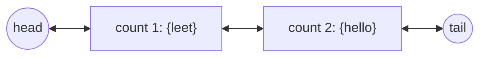

<!-- approaches: Doubly linked list of count buckets · TreeMap of counts -->
# 432. All O`one Data Structure

**Hard** · Hash Table · Linked List · Design · Doubly-Linked List · [LeetCode ↗](https://leetcode.com/problems/all-oone-data-structure/) · Code: [AllOOneDataStructure.java](AllOOneDataStructure.java) · Tests: [AllOOneDataStructureTest.java](AllOOneDataStructureTest.java)

## Đề bài

Thiết kế `AllOne`: `inc(key)` / `dec(key)` tăng / giảm số đếm của khoá một đơn vị (về 0 thì khoá biến mất); `getMaxKey` / `getMinKey` trả về một khoá có số đếm lớn nhất / nhỏ nhất. **Mọi thao tác `O(1)`**.

## Ý tưởng

> Số đếm chỉ thay đổi **±1** mỗi lần → một khoá chỉ di chuyển sang **nhóm kề bên**. Giữ các nhóm (mỗi nhóm = một số đếm + tập khoá) trong một **danh sách liên kết đôi sắp theo số đếm**. Đầu danh sách là nhóm nhỏ nhất, cuối là nhóm lớn nhất.

| thao tác | việc làm |
|---|---|
| `inc(key)` | nhóm kế tiếp có `count + 1`? nếu chưa thì tạo ngay sau nhóm hiện tại; chuyển khoá sang đó |
| `dec(key)` | tương tự về phía trước (`count − 1`); count = 1 thì xoá khoá |
| nhóm rỗng | gỡ khỏi danh sách |
| `getMax/MinKey` | một khoá bất kỳ của nhóm cuối / đầu |

Hai node lính canh `head`, `tail` giúp không phải xử lý trường hợp danh sách rỗng hay ở biên.

## Cách 1 — Danh sách liên kết đôi các nhóm `O(1)` ⭐

Giống cách LFU Cache (460) dùng các "nhóm tần suất", nhưng ở đây nhóm phải **liền kề theo thứ tự** để lấy được cả min và max.

## Cách 2 — `TreeMap` số đếm → khoá

Ngắn gọn, `O(log n)` mỗi thao tác. Dùng làm chuẩn để test (kết quả max/min có thể là bất kỳ khoá nào cùng số đếm, nên test kiểm tra **số đếm** chứ không so khoá).

## Bài liên quan

460 LFU Cache · 146 LRU Cache · 895 Maximum Frequency Stack · 381 Insert Delete GetRandom O(1) - Duplicates allowed.
