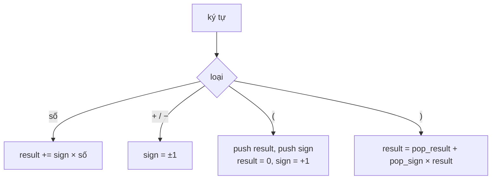

<!-- approaches: Stack of signs with running result · Recursive descent -->
# 224. Basic Calculator

**Hard** · Math · String · Stack · Recursion · [LeetCode ↗](https://leetcode.com/problems/basic-calculator/) · Code: [BasicCalculator.java](BasicCalculator.java) · Tests: [BasicCalculatorTest.java](BasicCalculatorTest.java)

## Đề bài

Tính biểu thức gồm số nguyên không âm, `+`, `−`, ngoặc và dấu cách; `−` có thể là dấu **một ngôi** (`"-(2+3)"`). Không dùng `eval`.

```
"(1+(4+5+2)-3)+(6+8)" -> 23
```

## Ý tưởng

> Chỉ có `+` và `−` nên không cần thứ tự ưu tiên — chỉ cần biết **dấu thực sự** của mỗi số. Duy trì `result` và `sign` hiện tại. Gặp `(`: **cất** `(result, sign)` vào stack, bắt đầu tính biểu thức con từ đầu. Gặp `)`: lấy ra, `result = resultTrước + signTrước × result`.

`"1 - (2 + 3)"`:

| ký tự | result | sign | stack |
|---|---|---|---|
| 1 | 1 | + | |
| − | 1 | − | |
| ( | 0 | + | 1, − |
| 2 | 2 | + | 1, − |
| + 3 | 5 | + | 1, − |
| ) | 1 − 5 = −4 | | |



## Cách 1 — Stack dấu + kết quả tạm ⭐

Số có nhiều chữ số: đọc liền cho tới hết chữ số. Dấu một ngôi tự xử lý được vì `result` bắt đầu bằng 0 (`−1` = `0 − 1`).

## Cách 2 — Phân tích đệ quy (recursive descent)

Viết theo ngữ pháp: `expr := term (('+' | '−') term)*`, `term := số | '(' expr ')' | '−' term`. Dễ mở rộng thêm `×`, `÷` (bài 227, 772) bằng cách thêm một tầng ngữ pháp.

## Bài liên quan

227 Basic Calculator II · 772 Basic Calculator III · 150 Evaluate Reverse Polish Notation · 394 Decode String.
