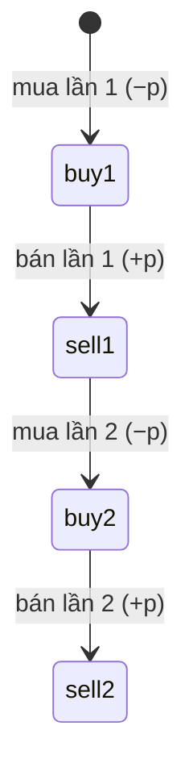

<!-- approaches: Split point with prefix/suffix best · Four-state DP -->
# 123. Best Time to Buy and Sell Stock III

**Hard** · Array · Dynamic Programming · [LeetCode ↗](https://leetcode.com/problems/best-time-to-buy-and-sell-stock-iii/) · Code: [BestTimeToBuyAndSellStockIII.java](BestTimeToBuyAndSellStockIII.java) · Tests: [BestTimeToBuyAndSellStockIIITest.java](BestTimeToBuyAndSellStockIIITest.java)

## Đề bài

Lợi nhuận lớn nhất với **tối đa hai giao dịch** (phải bán xong mới được mua lại).

```
[3,3,5,0,0,3,1,4] -> 6    mua 0 bán 3 (+3), mua 1 bán 4 (+3)
```

## Ý tưởng 1 — Chia đôi theo ngày

> Hai giao dịch không chồng nhau luôn có một **ngày ranh giới**: giao dịch 1 nằm bên trái, giao dịch 2 bên phải. Tính trước:
> - `left[i]` = lãi tốt nhất với **một** giao dịch trong ngày `0..i` (như bài 121, đi từ trái);
> - `right[i]` = lãi tốt nhất với một giao dịch trong ngày `i..n−1` (đi từ phải, giữ giá **cao nhất**).
> Đáp án = `max(left[i] + right[i])`.

## Ý tưởng 2 — Máy bốn trạng thái ⭐

> Mở rộng bài 122: thay vì hai trạng thái, có **bốn** mốc theo thứ tự.



| giá | buy1 | sell1 | buy2 | sell2 |
|---|---|---|---|---|
| 3 | −3 | 0 | −3 | 0 |
| 5 | −3 | 2 | −3 | 2 |
| 0 | 0 | 2 | 2 | 2 |
| 3 | 0 | 3 | 2 | 5 |
| 1 | 0 | 3 | 2 | 5 |
| 4 | 0 | 4 | 2 | **6** |

Cập nhật theo thứ tự `buy1 → sell1 → buy2 → sell2` trong cùng một ngày cũng không sai: dùng giá trị "mới" chỉ tương ứng với mua và bán **cùng ngày** — lãi bằng 0, không tạo lợi thế giả.

## So sánh họ "Best Time"

| Bài | Số giao dịch | Trạng thái |
|---|---|---|
| 121 | 1 | min giá |
| 122 | ∞ | hold / free |
| 123 (bài này) | 2 | 4 trạng thái |
| 188 | k | 2k trạng thái |
| 309 | ∞ + nghỉ | 3 trạng thái |
| 714 | ∞ + phí | 2 trạng thái |

## Bài liên quan

121 · 122 · 188 Best Time IV · 309 with Cooldown · 714 with Transaction Fee.
