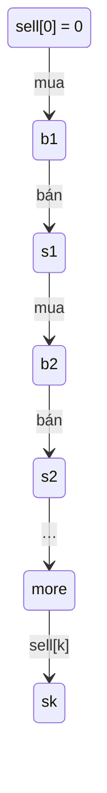

<!-- approaches: DP with 2k states · Unlimited transactions shortcut when k >= n/2 -->
# 188. Best Time to Buy and Sell Stock IV

**Hard** · Array · Dynamic Programming · [LeetCode ↗](https://leetcode.com/problems/best-time-to-buy-and-sell-stock-iv/) · Code: [BestTimeToBuyAndSellStockIV.java](BestTimeToBuyAndSellStockIV.java) · Tests: [BestTimeToBuyAndSellStockIVTest.java](BestTimeToBuyAndSellStockIVTest.java)

## Đề bài

Lợi nhuận lớn nhất với **tối đa `k` giao dịch**.

```
k = 2, [3,2,6,5,0,3] -> 7    mua 2 bán 6 (+4), mua 0 bán 3 (+3)
```

## Ý tưởng

> Tổng quát hoá bài 123 (k = 2): thay 4 trạng thái bằng `2k` trạng thái `buy[1..k]`, `sell[1..k]`:
> - `buy[j]` = tiền tốt nhất sau lần **mua** thứ `j` = `max(buy[j], sell[j−1] − giá)`;
> - `sell[j]` = tiền tốt nhất sau lần **bán** thứ `j` = `max(sell[j], buy[j] + giá)`.



**Tối ưu quan trọng:** một giao dịch có lãi cần ít nhất 2 ngày, nên có tối đa `n/2` giao dịch có ích. Nếu `k ≥ n/2` thì giới hạn **không bao giờ chặn** → bài thành 122 (cộng mọi bước tăng), `O(n)`. Thiếu tối ưu này, `k = 10⁹` sẽ làm tràn bộ nhớ.

## Cách 1 — 2k trạng thái + rút gọn khi k lớn `O(n·min(k, n))` ⭐

## Cách 2 — Bảng `dp[j][i]`

`dp[j][i] = max(dp[j][i−1], prices[i] + max_{m<i}(dp[j−1][m] − prices[m]))`. Phần `max` bên trong được duy trì bằng một biến chạy (`bestBuy`) thay vì vòng lặp, nên mỗi ô `O(1)`.

## Bài liên quan

121 (k = 1) · 122 (k = ∞) · 123 (k = 2) · 309 with Cooldown · 714 with Transaction Fee.
