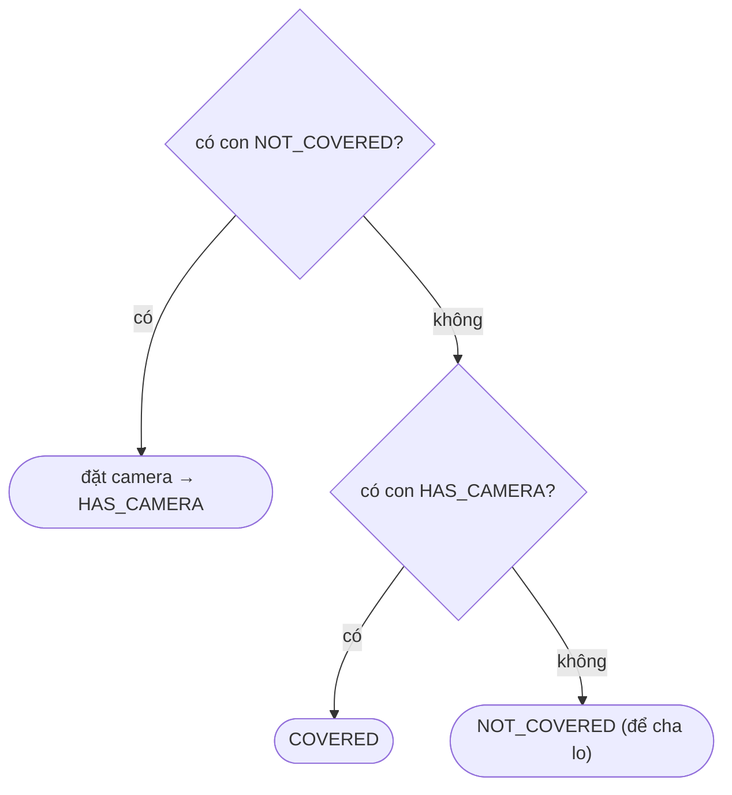

<!-- approaches: Greedy postorder with three states · DP returning three costs per node -->
# 968. Binary Tree Cameras

**Hard** · Dynamic Programming · Tree · Depth-First Search · Binary Tree · [LeetCode ↗](https://leetcode.com/problems/binary-tree-cameras/) · Code: [BinaryTreeCameras.java](BinaryTreeCameras.java) · Tests: [BinaryTreeCamerasTest.java](BinaryTreeCamerasTest.java)

## Đề bài

Đặt camera lên các node của cây; mỗi camera giám sát **node cha, chính nó và các con**. Cần ít camera nhất để giám sát mọi node.

```
      0
     /
    0*         -> 1 camera (đặt ở node *)
   / \
  0   0
```

## Ý tưởng

> **Không bao giờ đặt camera ở lá** — đặt ở cha của lá thì phủ được lá, chính nó, **và** cả node ông. Đi **từ dưới lên** (postorder), mỗi node báo cho cha một trong ba trạng thái:

| trạng thái | ý nghĩa |
|---|---|
| `NOT_COVERED` | chưa được giám sát — cha **phải** đặt camera |
| `HAS_CAMERA` | có camera — cha được giám sát |
| `COVERED` | đã được giám sát, nhưng không có camera |



`null` coi là `COVERED` (không cần giám sát, cũng không giúp gì). Cuối cùng nếu **gốc** vẫn `NOT_COVERED` thì thêm một camera ở gốc (không có cha để lo).

## Cách 1 — Tham lam ba trạng thái `O(n)` ⭐

## Cách 2 — DP chính xác trên cây

Mỗi node trả về ba chi phí cho cây con của nó: **có camera**, **được phủ mà không có camera**, **chưa được phủ** (để cha phủ). Ghép từ hai con. Không cần lập luận tham lam — dùng để kiểm chứng (test so cả hai với vét cạn).

## Bài liên quan

337 House Robber III (DP trên cây hai trạng thái) · 979 Distribute Coins in Binary Tree · 2477 Minimum Fuel Cost to Report to the Capital.
