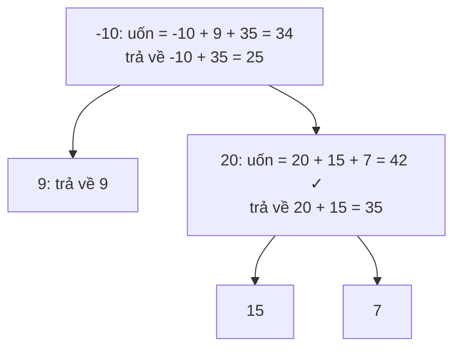

<!-- approaches: One DFS returning the best downward gain -->
# 124. Binary Tree Maximum Path Sum

**Hard** · Dynamic Programming · Tree · Depth-First Search · Binary Tree · [LeetCode ↗](https://leetcode.com/problems/binary-tree-maximum-path-sum/) · Code: [BinaryTreeMaximumPathSum.java](BinaryTreeMaximumPathSum.java) · Tests: [BinaryTreeMaximumPathSumTest.java](BinaryTreeMaximumPathSumTest.java)

## Đề bài

**Đường đi** là dãy các node kề nhau, mỗi node dùng tối đa một lần (không nhất thiết qua gốc). Tìm tổng giá trị **lớn nhất** của một đường đi khác rỗng.

```
   -10
   /  \
  9   20        -> 42   (15 → 20 → 7)
     /  \
    15   7
```

## Ý tưởng

> Khuôn "**trả về một thứ, cập nhật thứ khác**" của bài 543 Diameter:
> - **Trả về cho cha** `gain(node)` = đường đi tốt nhất **đi xuống** từ `node` theo **một** nhánh: `val + max(0, gain(trái), gain(phải))`.
> - **Cập nhật đáp án** với đường đi **uốn tại** `node` (đi qua cả hai nhánh): `val + max(0, gain(trái)) + max(0, gain(phải))`.
> Nhánh có tổng âm thì **bỏ** (lấy `max(0, …)`).



## Lời giải — Một lần DFS hậu thứ tự `O(n)` ⭐

**Vì sao cha chỉ nhận một nhánh?** Đường đi không được rẽ hai lần: nếu cha nối tiếp vào, đường đi từ cha xuống chỉ được đi tiếp theo **một** phía của `node`.

## Bẫy & lưu ý

- Cây toàn số âm → đáp án là node **lớn nhất** (đường đi phải khác rỗng). Khởi tạo `best = MIN_VALUE`, không phải 0.
- Test so với vét cạn **mọi cặp node** (đường đi đi qua tổ tiên chung thấp nhất).

## Bài liên quan

543 Diameter of Binary Tree · 687 Longest Univalue Path · 112 Path Sum · 2246 Longest Path With Different Adjacent Characters.
