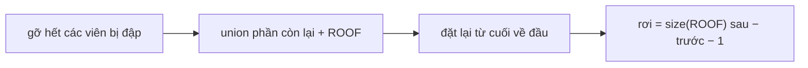

<!-- approaches: Reverse time with union-find and a virtual roof node -->
# 803. Bricks Falling When Hit

**Hard** · Array · Union-Find · Matrix · [LeetCode ↗](https://leetcode.com/problems/bricks-falling-when-hit/) · Code: [BricksFallingWhenHit.java](BricksFallingWhenHit.java) · Tests: [BricksFallingWhenHitTest.java](BricksFallingWhenHitTest.java)

## Đề bài

Lưới gạch (`1`) và ô trống (`0`). Viên gạch **ổn định** nếu ở hàng trên cùng hoặc nối (4 hướng) với một viên ổn định. Mỗi lần `hits[i]` đập vỡ một ô; gạch mất ổn định **rơi ngay**. Trả về số gạch rơi sau mỗi lần đập.

```
1 0 0 0
1 1 1 0     đập (1,0) → (1,1), (1,2) mất chỗ bám → rơi 2
```

## Ý tưởng — chạy ngược thời gian

> Đập gạch = **cắt** liên thông — union-find không hỗ trợ tách. Nhưng **đặt gạch trở lại** = **nối** — đúng sở trường của union-find.
> 1. Gỡ trước **tất cả** các viên sẽ bị đập.
> 2. Union phần còn lại; hàng trên cùng nối với một node ảo **ROOF**.
> 3. Đặt lại các viên theo thứ tự **ngược**. Mỗi lần, thành phần của ROOF lớn thêm `Δ`. Số gạch rơi ở lần đập đó = `Δ − 1` (trừ chính viên được đặt lại).



| bước (ngược) | size(ROOF) trước | sau | rơi |
|---|---|---|---|
| đặt lại (1,0) | 2 (ROOF + (0,0)) | 5 | 5 − 2 − 1 = **2** |

## Lời giải `O((m·n + h)·α)` ⭐

Chi tiết:
- Ô bị đập mà **vốn trống** (hoặc đập trùng) → không làm gì, trả về 0. Đánh dấu bằng giá trị `2` khi gỡ.
- Viên đặt lại nhưng không nối được tới ROOF → `Δ = 0`, kết quả `max(0, −1) = 0`.

Gạch đã lơ lửng ngay từ lưới ban đầu không bao giờ được tính là "rơi" (cách hiểu của lời giải chính thức) — bộ mô phỏng trong test cũng loại chúng trước khi đập.

Test so với mô phỏng xuôi (loang từ hàng trên sau mỗi lần đập).

## Bài liên quan

1970 Last Day Where You Can Still Cross · 305 Number of Islands II · 1697 Checking Existence of Edge Length Limited Paths (cũng xử lý offline).
