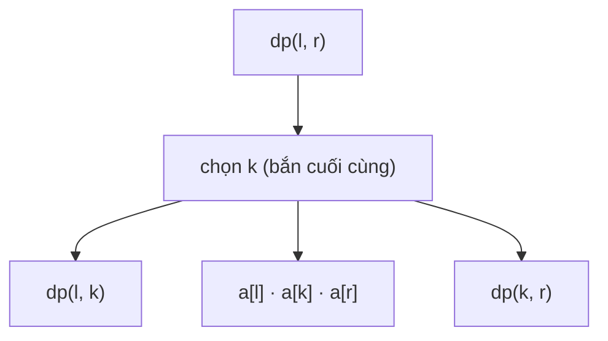

<!-- approaches: Interval DP choosing the last balloon · Memoized recursion -->
# 312. Burst Balloons

**Hard** · Array · Dynamic Programming · [LeetCode ↗](https://leetcode.com/problems/burst-balloons/) · Code: [BurstBalloons.java](BurstBalloons.java) · Tests: [BurstBalloonsTest.java](BurstBalloonsTest.java)

## Đề bài

Bắn bóng `i` được `nums[i−1] · nums[i] · nums[i+1]` xu (ngoài biên coi là 1); sau đó hai bóng hai bên trở thành kề nhau. Bắn hết bóng, được nhiều xu nhất là bao nhiêu?

```
[3,1,5,8] -> 167
  bắn 1: 3·1·5 = 15   -> [3,5,8]
  bắn 5: 3·5·8 = 120  -> [3,8]
  bắn 3: 1·3·8 = 24   -> [8]
  bắn 8: 1·8·1 = 8    -> tổng 167
```

## Ý tưởng

> Nghĩ theo bóng bắn **đầu tiên** thì khó: hai bên trở nên **phụ thuộc** nhau (hàng xóm thay đổi).
> Nghĩ theo bóng bắn **cuối cùng** `k` trong khoảng mở `(l, r)`: lúc bắn nó, mọi bóng khác trong khoảng đã nổ hết → hàng xóm của nó **chắc chắn** là `a[l]` và `a[r]`. Hai phía `(l, k)` và `(k, r)` trở thành hai bài toán **độc lập**.

Thêm hai bóng giả giá trị 1 ở hai đầu: `a = [1, 3, 1, 5, 8, 1]`.



`dp[l][r] = max over k of dp[l][k] + a[l]·a[k]·a[r] + dp[k][r]`, đáp án `dp[0][n+1]`.

## Cách 1 — DP khoảng từ dưới lên `O(n³)` ⭐

Điền theo **độ dài khoảng tăng dần** để các khoảng con luôn có sẵn.

## Cách 2 — Đệ quy có nhớ

Cùng công thức, viết từ trên xuống — dễ nghĩ ra hơn khi phỏng vấn.

## Bài học

"**Chọn phần tử cuối cùng**" thay vì đầu tiên là mẹo then chốt của nhiều bài DP khoảng: 1039 Minimum Score Triangulation of Polygon, 1547 Minimum Cost to Cut a Stick, 664 Strange Printer.

## Bài liên quan

1547 Minimum Cost to Cut a Stick · 1039 Minimum Score Triangulation of Polygon · 516 Longest Palindromic Subsequence · 1000 Minimum Cost to Merge Stones.
