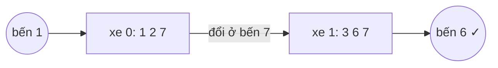

<!-- approaches: BFS over buses (routes) · BFS over stops -->
# 815. Bus Routes

**Hard** · Array · Hash Table · Breadth-First Search · [LeetCode ↗](https://leetcode.com/problems/bus-routes/) · Code: [BusRoutes.java](BusRoutes.java) · Tests: [BusRoutesTest.java](BusRoutesTest.java)

## Đề bài

`routes[i]` là danh sách các bến của tuyến xe buýt `i` (chạy vòng). Đang ở bến `source` (chưa lên xe), cần **ít chuyến xe nhất** để tới bến `target`. Không thể → `−1`.

```
routes = [[1,2,7],[3,6,7]], source = 1, target = 6 -> 2    (xe 0 tới bến 7, đổi sang xe 1)
```

## Ý tưởng

> Đại lượng cần tối thiểu là **số xe**, không phải số bến → BFS trong đó mỗi **tầng là một chuyến xe**. Đỉnh của BFS là các **tuyến xe**: hai tuyến kề nhau nếu chung một bến.
> Bảng `bến → các tuyến đi qua` giúp tìm tuyến kề nhanh.



| tầng (số xe) | các tuyến | bến mới đi tới |
|---|---|---|
| 1 | xe 0 | 1, 2, 7 |
| 2 | xe 1 (qua bến 7) | 3, **6** ✓ |

## Cách 1 — BFS trên tuyến xe `O(tổng số bến)` ⭐

Đánh dấu cả **tuyến** và **bến** đã thăm: mỗi bến chỉ cần mở rộng một lần, mỗi tuyến chỉ đi một lần. Không đánh dấu bến thì một bến thuộc nhiều tuyến bị xét đi xét lại.

## Cách 2 — BFS trên bến, đánh dấu tuyến đã đi

Đỉnh là bến; từ một bến lên mọi tuyến **chưa đi**, mọi bến trên tuyến đó cách thêm 1 chuyến. Đánh dấu tuyến đã đi để không quét lại cả tuyến.

## Bẫy & lưu ý

- `source == target` → 0 (không cần lên xe).
- BFS trên bến mà **không** đánh dấu tuyến → `O(bến × độ dài tuyến)` mỗi lần, quá chậm với tuyến dài 10⁵ bến.

## Bài liên quan

127 Word Ladder · 1345 Jump Game IV (cũng "xoá nhóm sau khi dùng") · 787 Cheapest Flights Within K Stops · 433 Minimum Genetic Mutation.
