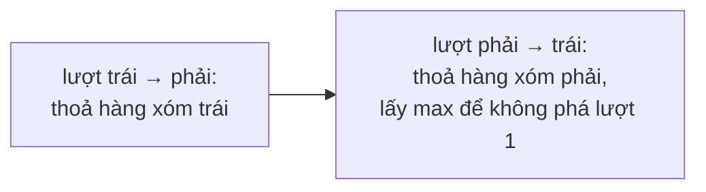

<!-- approaches: Two passes (left and right neighbours) · One pass counting slopes -->
# 135. Candy

**Hard** · Array · Greedy · [LeetCode ↗](https://leetcode.com/problems/candy/) · Code: [Candy.java](Candy.java) · Tests: [CandyTest.java](CandyTest.java)

## Đề bài

Trẻ đứng thành hàng, mỗi trẻ có điểm `ratings[i]`. Mỗi trẻ ít nhất 1 kẹo; trẻ điểm **cao hơn hàng xóm** phải được **nhiều kẹo hơn** hàng xóm đó. Tổng kẹo ít nhất?

```
[1,0,2] -> 5   (2, 1, 2)          [1,2,2] -> 4   (1, 2, 1)
```

## Ý tưởng

> Điều kiện gồm hai phía độc lập: hơn hàng xóm **trái** và hơn hàng xóm **phải**. Xử lý từng phía một lượt:
> - **Trái → phải:** điểm cao hơn bên trái → `c[i] = c[i−1] + 1`.
> - **Phải → trái:** điểm cao hơn bên phải → `c[i] = max(c[i], c[i+1] + 1)` (giữ kết quả lượt trước).

`[1, 3, 4, 5, 2]`:

| | 1 | 3 | 4 | 5 | 2 |
|---|---|---|---|---|---|
| lượt trái | 1 | 2 | 3 | 4 | 1 |
| lượt phải | 1 | 2 | 3 | max(4, 2) = 4 | 1 |
| tổng | | | | | 1 + 2 + 3 + 4 + 1 = **11** |



## Cách 1 — Hai lượt `O(n) · O(n)` ⭐

## Cách 2 — Đếm sườn dốc, một lượt `O(1)` bộ nhớ

Dãy điểm là các **sườn lên** và **sườn xuống**. Sườn lên dài `u` cần thêm `1 + 2 + … + u`; sườn xuống tương tự. Đỉnh thuộc về sườn **dài hơn** — khi sườn xuống dài vượt sườn lên, đỉnh cũng phải được thêm kẹo. Tinh tế, dễ sai; chỉ nên trình bày sau khi đã có cách 1.

## Bẫy & lưu ý

- Hai trẻ **bằng điểm** đứng cạnh nhau **không** có ràng buộc gì (ví dụ `[1,2,2]` → trẻ cuối chỉ cần 1 kẹo).

## Bài liên quan

42 Trapping Rain Water (cùng kiểu hai lượt trái/phải) · 238 Product of Array Except Self · 2214 Minimum Health to Beat Game.
