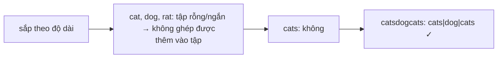

<!-- approaches: Word break DP per word against a set · Trie + DFS -->
# 472. Concatenated Words

**Hard** · Array · String · Dynamic Programming · Depth-First Search · [LeetCode ↗](https://leetcode.com/problems/concatenated-words/) · Code: [ConcatenatedWords.java](ConcatenatedWords.java) · Tests: [ConcatenatedWordsTest.java](ConcatenatedWordsTest.java)

## Đề bài

Tìm mọi từ trong danh sách được **ghép từ ít nhất hai từ ngắn hơn** cũng có trong danh sách.

```
["cat","cats","catsdogcats","dog","dogcatsdog","hippopotamuses","rat","ratcatdogcat"]
-> ["catsdogcats" (cats+dog+cats), "dogcatsdog", "ratcatdogcat"]
```

## Ý tưởng

> Mỗi từ là một bài **Word Break (139)** với từ điển là **các từ khác**. Một từ chỉ có thể ghép từ các từ **ngắn hơn** nó → sắp xếp theo độ dài; kiểm tra từng từ với tập các từ ngắn hơn, rồi mới thêm nó vào tập. Như vậy tự động loại trường hợp "từ ghép từ chính nó".



Word Break DP trên `"catsdogcats"`: `ok[i]` = tiền tố dài `i` tách được.

| i | 3 | 4 | 7 | 10 | 11 |
|---|---|---|---|---|---|
| tách được nhờ | cat | cats | cats+dog | …+cat | …+cats ✓ |

## Cách 1 — Sắp theo độ dài + Word Break `O(n·L²)` ⭐

## Cách 2 — Trie + DFS có nhớ

Đưa mọi từ vào Trie. Với mỗi từ, đi trong Trie từ vị trí `start`; mỗi lần chạm điểm kết thúc từ thì thử đệ quy phần còn lại. Bắt buộc dùng **ít nhất hai mảnh**: khi `start = 0` mà mảnh đầu đã là cả từ thì không tính.

## Bài liên quan

139 Word Break · 140 Word Break II · 720 Longest Word in Dictionary · 208 Implement Trie.
