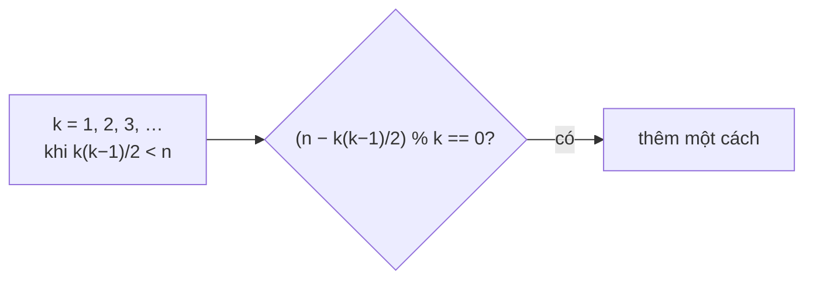

<!-- approaches: Count lengths k with an integer start · Count odd divisors -->
# 829. Consecutive Numbers Sum

**Hard** · Math · Enumeration · [LeetCode ↗](https://leetcode.com/problems/consecutive-numbers-sum/) · Code: [ConsecutiveNumbersSum.java](ConsecutiveNumbersSum.java) · Tests: [ConsecutiveNumbersSumTest.java](ConsecutiveNumbersSumTest.java)

## Đề bài

Có bao nhiêu cách viết `n` thành tổng của **một hoặc nhiều số nguyên dương liên tiếp**?

```
15 -> 4:   15 · 7+8 · 4+5+6 · 1+2+3+4+5
```

## Ý tưởng

> Một tổng gồm `k` số liên tiếp bắt đầu từ `x`:
> `n = x + (x+1) + … + (x+k−1) = k·x + k(k−1)/2`
> → `x = (n − k(k−1)/2) / k`. Với mỗi độ dài `k`, có **đúng một** cách nếu `x` là **số nguyên dương**.
> Cần `k(k−1)/2 < n` → `k` chỉ tới khoảng `√(2n)` (≈ 44 721 với `n = 10⁹`).

| k | n − k(k−1)/2 | chia hết cho k? | x |
|---|---|---|---|
| 1 | 15 | ✓ | 15 |
| 2 | 14 | ✓ | 7 |
| 3 | 12 | ✓ | 4 |
| 4 | 9 | ✗ | |
| 5 | 5 | ✓ | 1 |



## Cách 1 — Duyệt độ dài `k` `O(√n)` ⭐

## Cách 2 — Đếm ước lẻ

Một kết quả lý thuyết số đẹp: số cách **bằng số ước lẻ** của `n`. Bỏ hết thừa số 2, rồi số ước của phần lẻ = `Π (eᵢ + 1)` theo phân tích nguyên tố. Với `15 = 3·5`: `2·2 = 4` ✓.

## Bài liên quan

829 là bài "biến đổi công thức để giảm không gian tìm kiếm" — gần với 1015 Smallest Integer Divisible by K, 172 Factorial Trailing Zeroes, 279 Perfect Squares.
