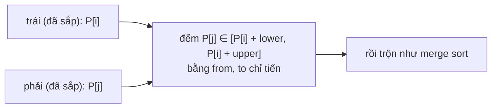

<!-- approaches: Brute force over prefix sums · Merge sort on prefix sums · Fenwick tree over compressed prefixes -->
# 327. Count of Range Sum

**Hard** · Array · Binary Search · Divide and Conquer · Binary Indexed Tree · [LeetCode ↗](https://leetcode.com/problems/count-of-range-sum/) · Code: [CountOfRangeSum.java](CountOfRangeSum.java) · Tests: [CountOfRangeSumTest.java](CountOfRangeSumTest.java)

## Đề bài

Đếm số **đoạn con** có tổng nằm trong `[lower, upper]`.

```
[-2,5,-1], lower = -2, upper = 2 -> 3     [-2], [-1], [-2,5,-1]
```

## Ý tưởng

> Tổng đoạn `(i, j]` = `P[j] − P[i]` với `P` là mảng tổng tiền tố (`P[0] = 0`). Bài thành: đếm cặp `i < j` có `lower ≤ P[j] − P[i] ≤ upper` — một bài **đếm cặp có điều kiện thứ tự**, giống đếm nghịch thế (315).

## Cách 1 — Mọi cặp tiền tố `O(n²)`

## Cách 2 — Merge sort trên tiền tố `O(n log n)` ⭐

Ở mỗi bước trộn, nửa trái và nửa phải đã sắp xếp, và mọi chỉ số nửa trái **nhỏ hơn** mọi chỉ số nửa phải (thứ tự gốc). Với mỗi `P[i]` bên trái, đếm `P[j]` bên phải nằm trong `[P[i] + lower, P[i] + upper]` bằng **hai con trỏ** `from`, `to` — vì `P[i]` tăng dần nên hai con trỏ chỉ tiến, không lùi.



## Cách 3 — Cây Fenwick trên tiền tố đã nén

Duyệt `P[j]` từ trái sang; cần đếm các `P[i]` **đã gặp** nằm trong `[P[j] − upper, P[j] − lower]` → truy vấn khoảng trên Fenwick. Giá trị tiền tố lớn → nén về hạng trước.

## Bẫy & lưu ý

- Tổng tiền tố vượt `int` (ví dụ `MIN_VALUE + MAX_VALUE …`) → dùng `long`. Test có ca này.

## Bài liên quan

315 Count of Smaller Numbers After Self · 493 Reverse Pairs · 560 Subarray Sum Equals K · 2426 Number of Pairs Satisfying Inequality.
