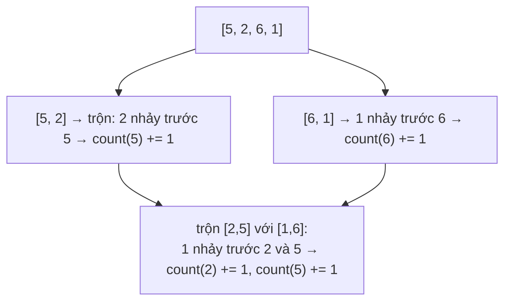

<!-- approaches: Merge sort counting jumps · Fenwick tree over ranks · Brute force -->
# 315. Count of Smaller Numbers After Self

**Hard** · Array · Binary Search · Divide and Conquer · Binary Indexed Tree · [LeetCode ↗](https://leetcode.com/problems/count-of-smaller-numbers-after-self/) · Code: [CountOfSmallerNumbersAfterSelf.java](CountOfSmallerNumbersAfterSelf.java) · Tests: [CountOfSmallerNumbersAfterSelfTest.java](CountOfSmallerNumbersAfterSelfTest.java)

## Đề bài

Với mỗi `nums[i]`, đếm số phần tử **bên phải** nó mà **nhỏ hơn** nó.

```
[5,2,6,1] -> [2,1,1,0]
```

## Ý tưởng 1 — Merge sort

> Trong merge sort, khi trộn nửa trái `L` và nửa phải `R` (đều đã sắp xếp), mọi phần tử của `R` ban đầu nằm **bên phải** mọi phần tử của `L`. Khi đặt một phần tử `x` của `L` vào kết quả, số phần tử của `R` **đã được đặt trước nó** chính là số phần tử bên phải nhỏ hơn `x` (trong nửa đó). Cộng dồn qua mọi tầng đệ quy.



Phải sắp xếp **chỉ số** (không phải giá trị) để biết cộng vào đâu.

## Ý tưởng 2 — Cây Fenwick (BIT)

> Đi **từ phải sang trái**, giữ một "bảng đếm" các giá trị đã gặp. Đáp án cho `nums[i]` = số giá trị đã gặp **nhỏ hơn** nó = một **tổng tiền tố** trên bảng đếm. Cây Fenwick hỗ trợ cập nhật và tổng tiền tố `O(log n)`. Giá trị lớn/âm → **nén** về hạng `1…k` trước.

## Cách 1 — Vét cạn `O(n²)`

## Cách 2 — Merge sort đếm `O(n log n)` ⭐

## Cách 3 — Fenwick tree trên hạng `O(n log n)`

## Bài liên quan

493 Reverse Pairs · 327 Count of Range Sum · 1649 Create Sorted Array through Instructions · 2179 Count Good Triplets in an Array.
