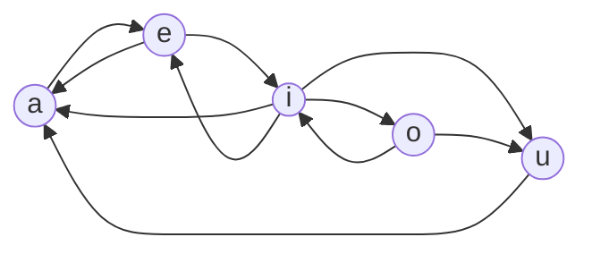

<!-- approaches: DP over the last vowel · Matrix exponentiation -->
# 1220. Count Vowels Permutation

**Hard** · Dynamic Programming · [LeetCode ↗](https://leetcode.com/problems/count-vowels-permutation/) · Code: [CountVowelsPermutation.java](CountVowelsPermutation.java) · Tests: [CountVowelsPermutationTest.java](CountVowelsPermutationTest.java)

## Đề bài

Đếm số chuỗi độ dài `n` chỉ gồm nguyên âm, theo luật: sau `a` chỉ có `e`; sau `e` là `a` hoặc `i`; sau `i` là bất kỳ trừ `i`; sau `o` là `i` hoặc `u`; sau `u` chỉ có `a`. Kết quả `mod 10⁹+7`.

```
n = 1 -> 5      n = 2 -> 10      n = 5 -> 68
```

## Ý tưởng

> Luật chỉ phụ thuộc vào **ký tự cuối** → trạng thái DP = "có bao nhiêu chuỗi hợp lệ dài `len` **kết thúc bằng** mỗi nguyên âm".
> Đảo luật để biết "**ai được đứng trước**" mỗi nguyên âm:



| kết thúc bằng | đứng trước được là | công thức |
|---|---|---|
| a | e, i, u | `a' = e + i + u` |
| e | a, i | `e' = a + i` |
| i | e, o | `i' = e + o` |
| o | i | `o' = i` |
| u | i, o | `u' = i + o` |

| len | a | e | i | o | u | tổng |
|---|---|---|---|---|---|---|
| 1 | 1 | 1 | 1 | 1 | 1 | 5 |
| 2 | 3 | 2 | 2 | 1 | 2 | 10 |
| 3 | 6 | 5 | 3 | 2 | 3 | 19 |

## Cách 1 — DP năm biến `O(n)` ⭐

Đây là bài đếm **đường đi độ dài `n − 1`** trên đồ thị 5 đỉnh ở trên.

## Cách 2 — Lũy thừa ma trận `O(5³ log n)`

Mỗi bước là phép nhân với **ma trận kề** cố định 5×5 → `n − 1` bước = lũy thừa ma trận, tính bằng bình phương liên tiếp (như 509 Fibonacci). Cần khi `n` lên tới 10¹⁸.

## Bài liên quan

935 Knight Dialer (cùng mẫu đếm đường đi trên đồ thị nhỏ) · 509 Fibonacci Number · 552 Student Attendance Record II · 790 Domino and Tromino Tiling.
