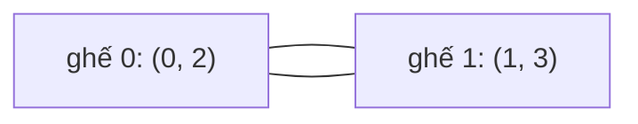

<!-- approaches: Greedy swaps with a position map · Union-find on couches -->
# 765. Couples Holding Hands

**Hard** · Greedy · Depth-First Search · Breadth-First Search · Union-Find · [LeetCode ↗](https://leetcode.com/problems/couples-holding-hands/) · Code: [CouplesHoldingHands.java](CouplesHoldingHands.java) · Tests: [CouplesHoldingHandsTest.java](CouplesHoldingHandsTest.java)

## Đề bài

`2n` ghế, `row[i]` là người ngồi ghế `i`. Các cặp đôi là `(0,1)`, `(2,3)`, … Cần **ít lần đổi chỗ** nhất (đổi hai người bất kỳ) để mọi cặp ngồi cạnh nhau (ghế `2k` và `2k+1`).

```
[0,2,1,3] -> 1   (đổi 2 và 1 → [0,1,2,3])
```

## Ý tưởng

> **Tham lam:** xét từng ghế đôi từ trái sang. Nếu người bên trái chưa ngồi cạnh bạn đời, kéo bạn đời về ghế bên phải bằng **một** lần đổi. Mỗi lần đổi xếp xong ít nhất một cặp, và không phá cặp nào đã xong.
> Bạn đời của `x` là `x ^ 1` (0↔1, 2↔3…). Mảng `pos` cho biết ai đang ngồi ở đâu để tìm trong `O(1)`.

**Vì sao tối ưu?** Nhìn theo đồ thị: mỗi **ghế đôi** là một đỉnh; hai người trên một ghế nối ghế đó với ghế của bạn đời họ. Mỗi đỉnh có bậc 2 → đồ thị là các **chu trình**. Một chu trình gồm `s` ghế cần đúng `s − 1` lần đổi (mỗi lần đổi tách được một ghế ra khỏi chu trình).



`[0,2,1,3]`: ghế 0 chứa 0 (cặp 0) và 2 (cặp 1); ghế 1 chứa 1 (cặp 0) và 3 (cặp 1) → một chu trình 2 ghế → `2 − 1 = 1` lần đổi.

## Cách 1 — Tham lam + bảng vị trí `O(n)` ⭐

## Cách 2 — Union-Find trên ghế

Hợp nhất hai **cặp đôi** (hay hai ghế "đích") xuất hiện trên cùng một ghế. Đáp án = `số ghế − số thành phần liên thông`.

## Bài liên quan

41 First Missing Positive (cyclic sort — cũng "đặt mỗi phần tử về đúng chỗ") · 854 K-Similar Strings · 2471 Minimum Number of Operations to Sort a Binary Tree by Level.
