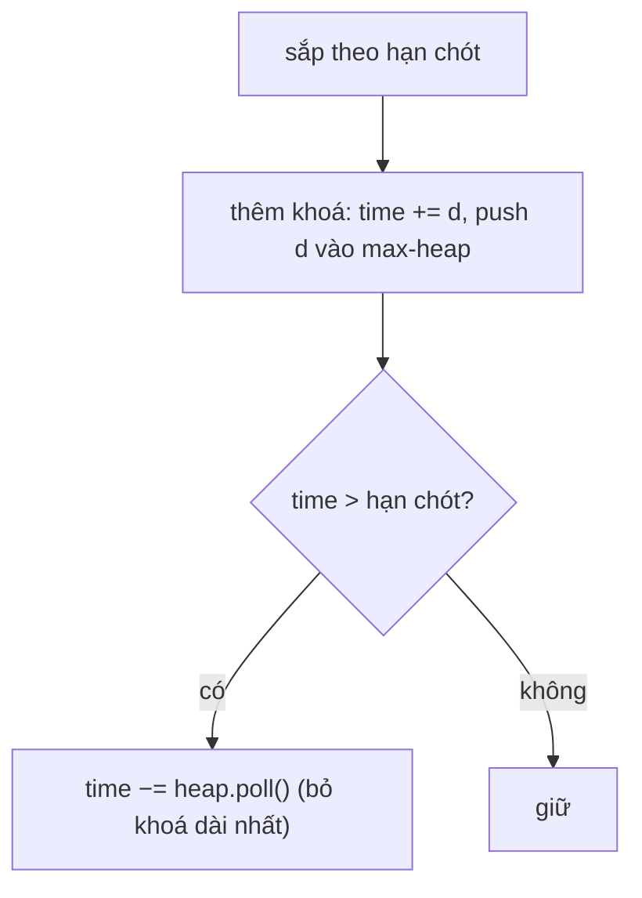

<!-- approaches: Sort by deadline + max-heap of durations · DP over time (small inputs) -->
# 630. Course Schedule III

**Hard** · Array · Greedy · Sorting · Heap (Priority Queue) · [LeetCode ↗](https://leetcode.com/problems/course-schedule-iii/) · Code: [CourseScheduleIII.java](CourseScheduleIII.java) · Tests: [CourseScheduleIIITest.java](CourseScheduleIIITest.java)

## Đề bài

Khoá học `[thời lượng, hạn chót]`: học liên tục `thời lượng` ngày và phải xong **trước hoặc đúng** hạn chót. Bắt đầu từ ngày 1, học lần lượt từng khoá. Học được **nhiều khoá nhất** là bao nhiêu?

```
[[100,200],[200,1300],[1000,1250],[2000,3200]] -> 3
```

## Ý tưởng

> Nếu đã chọn một tập khoá học, thứ tự tốt nhất là theo **hạn chót tăng dần** (lập luận đổi chỗ). Nên duyệt theo hạn chót.
> **Tham lam có hối hận:** luôn thêm khoá hiện tại; nếu tổng thời gian **vượt** hạn chót của nó, **bỏ khoá dài nhất** đã chọn (có thể chính là khoá vừa thêm). Số khoá không đổi so với trước, nhưng tổng thời gian **nhỏ nhất có thể** → để lại nhiều chỗ nhất cho các khoá sau.



| khoá (theo hạn) | time | vượt? | heap |
|---|---|---|---|
| [100, 200] | 100 | | 100 |
| [1000, 1250] | 1100 | | 1000 100 |
| [200, 1300] | 1300 | | 1000 200 100 |
| [2000, 3200] | 3300 | > 3200 → bỏ 2000 | 1000 200 100 |

→ **3** khoá.

## Cách 1 — Sắp theo hạn + max-heap `O(n log n)` ⭐

## Cách 2 — DP như knapsack theo thời gian

`dp[t]` = số khoá nhiều nhất khi dùng đúng `t` ngày; duyệt khoá theo hạn chót và chỉ cho phép `t ≤ hạn chót`. Đúng nhưng phụ thuộc giá trị ngày (tới 10⁴) — dùng làm chuẩn để test.

## Bài liên quan

435 Non-overlapping Intervals · 1353 Maximum Number of Events That Can Be Attended · 502 IPO · 871 Minimum Number of Refueling Stops (cùng kiểu "tham lam có hối hận" với heap).
