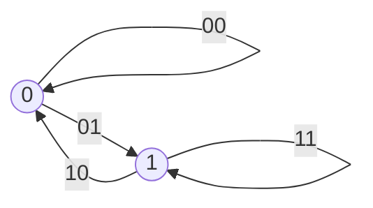

<!-- approaches: Hierholzer DFS on the de Bruijn graph · Greedy largest-digit-first (Lyndon words) -->
# 753. Cracking the Safe

**Hard** · String · Depth-First Search · Graph Theory · Eulerian Circuit · [LeetCode ↗](https://leetcode.com/problems/cracking-the-safe/) · Code: [CrackingTheSafe.java](CrackingTheSafe.java) · Tests: [CrackingTheSafeTest.java](CrackingTheSafeTest.java)

## Đề bài

Mật khẩu két sắt gồm `n` chữ số trong `0 … k−1`; két kiểm tra `n` chữ số **cuối cùng** vừa gõ. Tìm chuỗi **ngắn nhất** chứa mọi mật khẩu có thể làm chuỗi con.

```
n = 2, k = 2 -> "01100"    chứa 01, 11, 10, 00
```

## Ý tưởng

> Có `kⁿ` mật khẩu; chuỗi ngắn nhất có thể dài `kⁿ + n − 1` — mỗi chữ số gõ thêm tạo ra **đúng một** mật khẩu mới. Chuỗi như vậy gọi là **dãy de Bruijn**.
> Dựng đồ thị: mỗi **đỉnh** là một chuỗi `n − 1` chữ số; mỗi **mật khẩu** `abc…d` là một **cạnh** từ đỉnh `abc…` sang `bc…d`. Cần đi qua **mọi cạnh đúng một lần** → **chu trình Euler**.

`n = 2, k = 2`: đỉnh là `0` và `1`; cạnh là 4 mật khẩu.



Mỗi đỉnh có bậc vào = bậc ra = `k` → luôn tồn tại chu trình Euler.

## Cách 1 — Thuật toán Hierholzer ⭐

DFS từ đỉnh `00…0`; đi qua cạnh chưa dùng; **sau khi** quay về từ cạnh đó mới ghi chữ số (hậu thứ tự) — cách này tự động nối các chu trình con thành một chu trình lớn. Cuối cùng ghép thêm đỉnh xuất phát.

## Cách 2 — Tham lam "chữ số lớn nhất trước"

Bắt đầu bằng `n` số 0; mỗi bước nối thêm **chữ số lớn nhất** tạo ra mật khẩu mới chưa gặp. Có chứng minh rằng cách này không bao giờ bị kẹt (gắn với **từ Lyndon**). Ngắn gọn hơn, nhưng khó giải thích vì sao đúng.

## Bài liên quan

332 Reconstruct Itinerary (chu trình/đường Euler) · 2097 Valid Arrangement of Pairs · 753 là ví dụ điển hình của "đổi góc nhìn: đỉnh ↔ cạnh".
