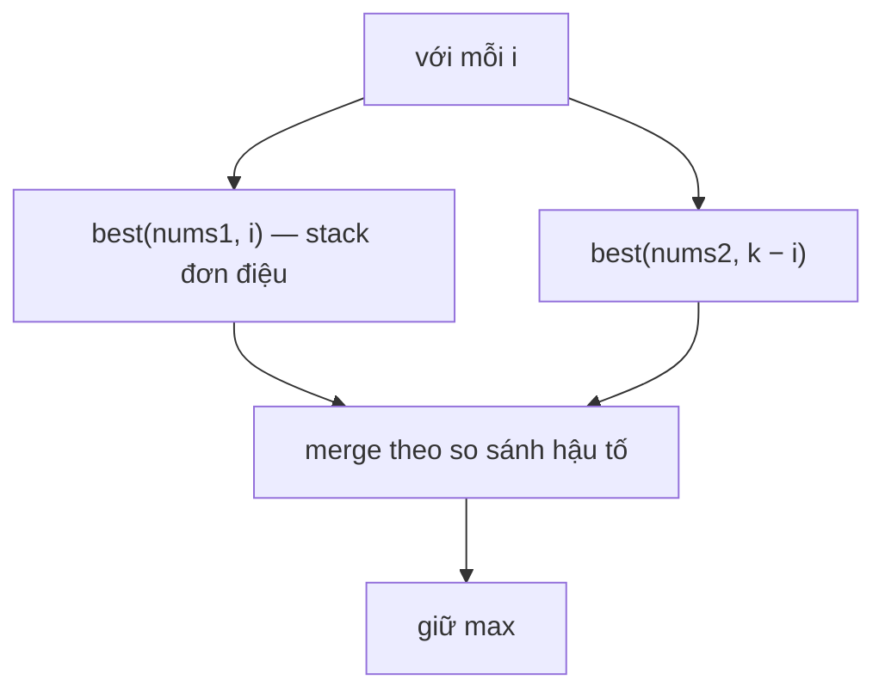

<!-- approaches: Best subsequence per split (monotonic stack) + greedy merge -->
# 321. Create Maximum Number

**Hard** · Array · Two Pointers · Stack · Greedy · [LeetCode ↗](https://leetcode.com/problems/create-maximum-number/) · Code: [CreateMaximumNumber.java](CreateMaximumNumber.java) · Tests: [CreateMaximumNumberTest.java](CreateMaximumNumberTest.java)

## Đề bài

Ghép số lớn nhất dài `k` từ các chữ số của `nums1` và `nums2`; chữ số lấy từ cùng một mảng phải giữ thứ tự ban đầu.

```
nums1 = [3,4,6,5], nums2 = [9,1,2,5,8,3], k = 5 -> [9,8,6,5,3]
```

## Ý tưởng — chia để trị ba tầng

> Thử mọi cách chia: lấy `i` chữ số từ `nums1` và `k − i` từ `nums2`. Với mỗi cách:
> 1. **Dãy con lớn nhất độ dài `t` của một mảng** — stack đơn điệu: gặp chữ số lớn hơn đỉnh thì bỏ đỉnh, miễn còn "quota bỏ" `n − t` (giống bài 402 Remove K Digits).
> 2. **Trộn hai dãy thành số lớn nhất** — luôn lấy từ dãy có **phần còn lại lớn hơn theo thứ tự từ điển**.
> 3. Giữ kết quả lớn nhất.

```
i = 2: best([3,4,6,5], 2) = [6,5]     best([9,1,2,5,8,3], 3) = [9,8,3]
       merge → [9,8,6,5,3] ✓
```



## Lời giải ⭐

**Bẫy khi trộn:** hai chữ số đầu bằng nhau thì **không** chọn bừa được. `[6,7]` và `[6,0,4]`: lấy 6 của dãy đầu trước → tiếp theo được 7 → `[6,7,6,0,4]`; lấy 6 của dãy sau trước → `[6,6,7,0,4]` nhỏ hơn. Phải so **cả phần còn lại** (`[6,7] > [6,0,4]`).

Test vét cạn mọi cách chọn và đan xen trên mảng nhỏ.

## Bài liên quan

402 Remove K Digits · 316 Remove Duplicate Letters · 1673 Find the Most Competitive Subsequence · 1754 Largest Merge Of Two Strings.
