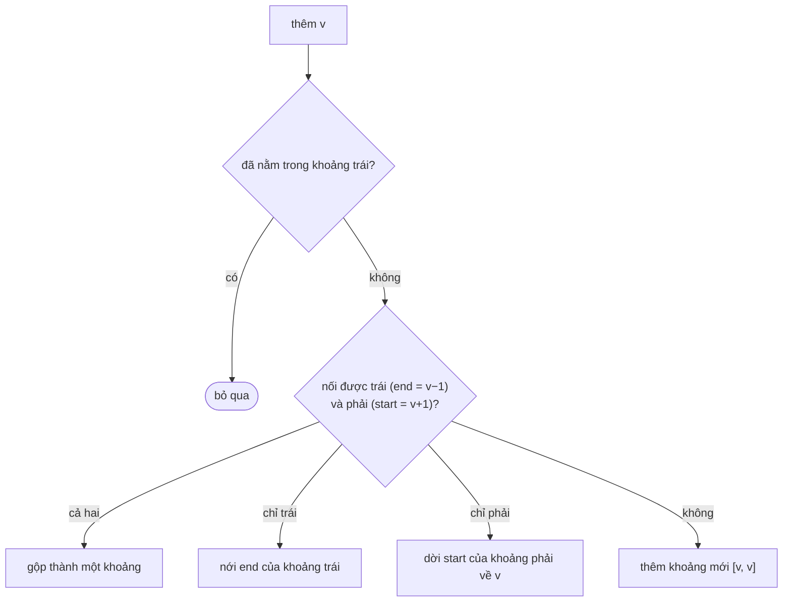

<!-- approaches: TreeMap of interval starts · Sorted set of values, build on demand -->
# 352. Data Stream as Disjoint Intervals

**Hard** · Hash Table · Binary Search · Union-Find · Design · [LeetCode ↗](https://leetcode.com/problems/data-stream-as-disjoint-intervals/) · Code: [DataStreamAsDisjointIntervals.java](DataStreamAsDisjointIntervals.java) · Tests: [DataStreamAsDisjointIntervalsTest.java](DataStreamAsDisjointIntervalsTest.java)

## Đề bài

Thiết kế `SummaryRanges`: `addNum(value)` nhận số từ một luồng; `getIntervals()` tóm tắt các số đã nhận thành các **khoảng rời nhau** đã sắp xếp.

```
add 1 → [1,1]
add 3 → [1,1] [3,3]
add 7 → [1,1] [3,3] [7,7]
add 2 → [1,3] [7,7]        (2 nối liền 1 và 3)
add 6 → [1,3] [6,7]
```

## Ý tưởng

> Lưu chính các **khoảng** trong một `TreeMap<start, end>` (cây cân bằng, các khoá luôn sắp xếp). Khi thêm `v`, chỉ cần nhìn **hai hàng xóm**: khoảng bắt đầu `≤ v` (`floorEntry`) và khoảng bắt đầu từ `v + 1` (`ceilingEntry`).



## Cách 1 — TreeMap các khoảng ⭐

`addNum` `O(log k)`, `getIntervals` `O(k)` với `k` là số khoảng. Tốt khi có **nhiều số gộp được** và gọi `getIntervals` thường xuyên (follow-up của đề).

## Cách 2 — TreeSet các giá trị, dựng khoảng khi được hỏi

`addNum` chỉ thêm vào set; `getIntervals` quét các giá trị theo thứ tự và gộp số liên tiếp. Đơn giản, nhưng `getIntervals` tốn `O(n)` theo số **giá trị** chứ không phải số khoảng.

## Bài liên quan

57 Insert Interval · 56 Merge Intervals · 715 Range Module · 228 Summary Ranges.
