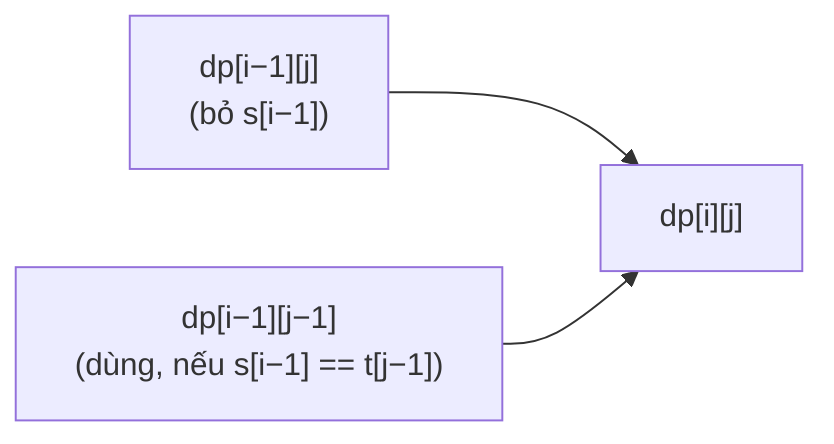

<!-- approaches: Memoized recursion · 2D DP · 1D DP iterating right to left -->
# 115. Distinct Subsequences

**Hard** · String · Dynamic Programming · [LeetCode ↗](https://leetcode.com/problems/distinct-subsequences/) · Code: [DistinctSubsequences.java](DistinctSubsequences.java) · Tests: [DistinctSubsequencesTest.java](DistinctSubsequencesTest.java)

## Đề bài

Đếm số **dãy con** của `s` bằng đúng `t` (tính theo vị trí, nên hai dãy con dùng các vị trí khác nhau được tính riêng).

```
("rabbbit", "rabbit") -> 3     (bỏ một trong ba chữ b)
```

## Ý tưởng

> Xét ký tự `s[i−1]`:
> - **Không dùng** nó → mọi cách tạo `t[0..j)` từ `s[0..i−1)`: `dp[i−1][j]`.
> - Nếu `s[i−1] == t[j−1]`, **dùng** nó để khớp ký tự cuối của `t` → `dp[i−1][j−1]`.
> Cộng hai trường hợp. `dp[i][0] = 1` (chuỗi rỗng luôn tạo được đúng một cách).



Bảng cho `s = "babgbag"`, `t = "bag"` (cột cuối):

| s tới | b | a | b | g | b | a | g |
|---|---|---|---|---|---|---|---|
| tạo "b" | 1 | 1 | 2 | 2 | 3 | 3 | 3 |
| tạo "ba" | 0 | 1 | 1 | 1 | 1 | 4 | 4 |
| tạo "bag" | 0 | 0 | 0 | 1 | 1 | 1 | **5** |

## Cách 1 — Đệ quy có nhớ

Cắt tỉa: phần còn lại của `s` ngắn hơn phần còn lại của `t` → 0.

## Cách 2 — Bảng 2D

## Cách 3 — Một hàng, `j` từ phải sang trái ⭐

Giống knapsack 0/1: duyệt ngược để `dp[j − 1]` còn là giá trị của **ký tự trước** — mỗi ký tự của `s` chỉ được dùng tối đa một lần cho mỗi vị trí của `t`.

## Bẫy & lưu ý

- Giá trị trung gian có thể lớn → dùng `long` (đề đảm bảo đáp án vừa `int`).

## Bài liên quan

1143 Longest Common Subsequence · 72 Edit Distance · 392 Is Subsequence · 940 Distinct Subsequences II.
