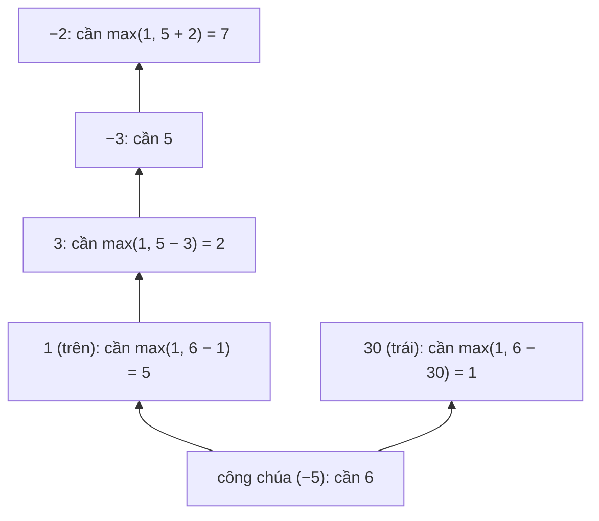

<!-- approaches: DP from the princess backwards · Binary search on starting health + forward check -->
# 174. Dungeon Game

**Hard** · Array · Dynamic Programming · Matrix · [LeetCode ↗](https://leetcode.com/problems/dungeon-game/) · Code: [DungeonGame.java](DungeonGame.java) · Tests: [DungeonGameTest.java](DungeonGameTest.java)

## Đề bài

Hiệp sĩ đi từ góc trên trái tới công chúa ở góc dưới phải, chỉ đi **phải** hoặc **xuống**. Mỗi ô cộng/trừ máu; máu phải **luôn ≥ 1**. Máu ban đầu ít nhất là bao nhiêu?

```
-2   -3    3
-5  -10    1        -> 7   (đường → → ↓ ↓)
10   30   -5
```

## Ý tưởng

> Đi **xuôi** từ đầu thì khó: một đường có thể còn nhiều máu ở cuối nhưng từng tụt rất thấp giữa đường — cần nhớ **hai** đại lượng, không DP được bằng một số.
> Đi **ngược** từ công chúa thì chỉ cần một đại lượng: `need[i][j]` = máu **tối thiểu khi bước vào** ô `(i, j)` để đi tới đích an toàn.
> `need[i][j] = max(1, min(need phải, need dưới) − dungeon[i][j])`.



Bảng `need`:

| | | |
|---|---|---|
| **7** | 5 | 2 |
| 6 | 11 | 5 |
| 1 | 1 | 6 |

`max(1, …)`: dù ô phía trước cho rất nhiều máu, khi bước vào vẫn phải có ít nhất 1.

## Cách 1 — DP ngược từ công chúa `O(m·n)` ⭐

Một hàng là đủ: `need[j]` (hàng dưới) và `need[j+1]` (ô bên phải, vừa tính).

## Cách 2 — Tìm kiếm nhị phân trên máu ban đầu

"Với `h` máu có sống sót tới đích không?" đơn điệu theo `h`. Kiểm tra bằng DP **xuôi**: giữ lượng máu **cao nhất** có thể khi tới mỗi ô (ô nào chết thì đánh dấu không tới được). Chậm hơn một hệ số `log`, nhưng cho thấy vì sao DP xuôi trực tiếp không đủ.

## Bài liên quan

64 Minimum Path Sum · 62 Unique Paths · 741 Cherry Pickup · 1631 Path With Minimum Effort.
