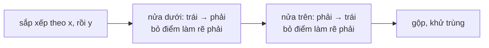

<!-- approaches: Andrew's monotone chain · Jarvis march (gift wrapping) -->
# 587. Erect the Fence

**Hard** · Array · Math · Geometry · Convex Hull · [LeetCode ↗](https://leetcode.com/problems/erect-the-fence/) · Code: [ErectTheFence.java](ErectTheFence.java) · Tests: [ErectTheFenceTest.java](ErectTheFenceTest.java)

## Đề bài

Các cây ở toạ độ nguyên. Rào tất cả bằng sợi dây **ngắn nhất**; trả về các cây nằm **trên hàng rào** (bao lồi, **kể cả** điểm nằm trên cạnh).

```
      (2,4)
   (3,3)         -> (1,1) (2,0) (4,2) (3,3) (2,4)      — (2,2) nằm bên trong
(1,1) (2,2) (4,2)
   (2,0)
```

## Ý tưởng

> Dây ngắn nhất bao quanh mọi điểm chính là **bao lồi** (convex hull). Công cụ chính: **tích có hướng** `cross(O, A, B)` cho biết đi `O → A → B` rẽ **trái** (> 0), **phải** (< 0) hay **thẳng hàng** (= 0).



## Cách 1 — Chuỗi đơn điệu của Andrew `O(n log n)` ⭐

Đi qua các điểm đã sắp xếp, giữ một "stack" bao. Điểm mới làm đường đi **rẽ phải** (`cross < 0`) thì điểm cuối của stack nằm **bên trong** → bỏ. Chỉ bỏ khi `< 0` (không bỏ khi `= 0`) để **giữ các điểm thẳng hàng trên cạnh** — yêu cầu riêng của bài này. Làm hai lượt (nửa dưới, nửa trên) rồi khử các điểm trùng.

## Cách 2 — Gói quà (Jarvis march) `O(n·h)`

Bắt đầu từ điểm trái nhất; mỗi bước chọn điểm `q` sao cho **mọi** điểm khác nằm bên trái cạnh `p → q` ("cuộn" dây quanh các điểm), thêm cả các điểm thẳng hàng nằm giữa `p` và `q`, rồi đi tiếp tới khi quay về điểm đầu. `h` = số điểm trên bao.

## Bẫy & lưu ý

- Mọi điểm **thẳng hàng** → bao lồi là cả đoạn thẳng; nửa dưới và nửa trên chứa cùng các điểm → phải khử trùng.
- Tích có hướng dùng `long` để không tràn.

## Bài liên quan

1924 Erect the Fence II (đường tròn bao nhỏ nhất) · 963 Minimum Area Rectangle II · 149 Max Points on a Line.
