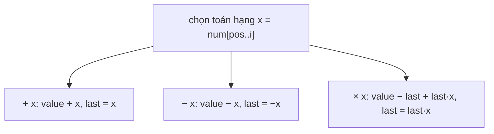

<!-- approaches: Backtracking tracking the last multiplied term -->
# 282. Expression Add Operators

**Hard** · Math · String · Backtracking · [LeetCode ↗](https://leetcode.com/problems/expression-add-operators/) · Code: [ExpressionAddOperators.java](ExpressionAddOperators.java) · Tests: [ExpressionAddOperatorsTest.java](ExpressionAddOperatorsTest.java)

## Đề bài

Chèn `+`, `−`, `×` (hoặc không chèn, để ghép thành số nhiều chữ số) vào giữa các chữ số của `num` sao cho biểu thức bằng `target`. Toán hạng không được có số 0 đứng đầu. Liệt kê mọi biểu thức.

```
"123", 6 -> ["1+2+3", "1*2*3"]       "105", 5 -> ["1*0+5", "10-5"]
```

## Ý tưởng

> Backtracking: mỗi bước chọn **toán hạng tiếp theo** (`num[pos..i]`) và **toán tử** đứng trước nó. Khó khăn duy nhất là `×` có **độ ưu tiên cao hơn**: `1 + 2 × 3` không phải `(1 + 2) × 3`.
> Mẹo: theo dõi **số hạng cuối cùng** đã cộng (`last`, có dấu). Khi gặp `× x`: **hoàn tác** số hạng cuối rồi cộng lại số hạng mới `last × x`:
> `value = value − last + last × x`, và `last` mới = `last × x`.

| biểu thức | value | last |
|---|---|---|
| `1` | 1 | 1 |
| `1 + 2` | 3 | 2 |
| `1 + 2 × 3` | 3 − 2 + 2·3 = 7 | 6 |
| `1 + 2 × 3 − 4` | 3 | −4 |



## Lời giải — Backtracking giữ `last` ⭐

- Toán hạng bắt đầu bằng `0` chỉ được là đúng `"0"` → `break` khi muốn kéo dài.
- Dùng `long` cho giá trị: ghép `"9999999999"` vượt `int`.
- Dùng chung một `StringBuilder`, cắt về độ dài cũ sau mỗi nhánh.

Test so với vét cạn mọi cách điền `4ⁿ⁻¹` khe, và kiểm tra lại từng biểu thức bằng một bộ tính riêng.

## Bài liên quan

224 Basic Calculator · 227 Basic Calculator II · 679 24 Game · 241 Different Ways to Add Parentheses · 494 Target Sum.
