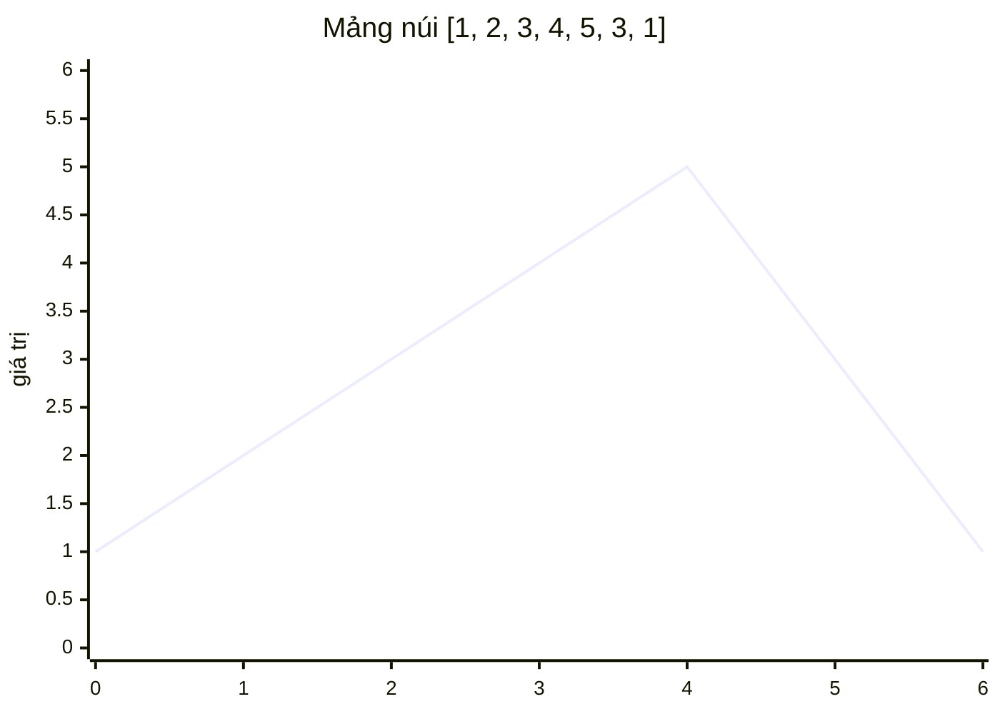

<!-- approaches: Three binary searches (peak, left side, right side) -->
# 1095. Find in Mountain Array

**Hard** · Array · Binary Search · Interactive · Ternary Search · [LeetCode ↗](https://leetcode.com/problems/find-in-mountain-array/) · Code: [FindInMountainArray.java](FindInMountainArray.java) · Tests: [FindInMountainArrayTest.java](FindInMountainArrayTest.java)

## Đề bài

**Mảng núi**: tăng ngặt tới **đỉnh**, rồi giảm ngặt. Chỉ truy cập được qua `get(i)` và `length()`, **tối đa 100 lần `get`**. Tìm chỉ số **nhỏ nhất** có giá trị `target`, không có → `−1`.

```
[1,2,3,4,5,3,1], target = 3 -> 2   (cả chỉ số 2 và 5 đều là 3, lấy 2)
```

## Ý tưởng

> Mảng núi gồm **hai đoạn đơn điệu** → ba lần tìm kiếm nhị phân:
> 1. **Tìm đỉnh**: `get(mid) < get(mid + 1)` → đang leo lên, đỉnh ở bên phải; ngược lại đỉnh ở `mid` hoặc bên trái.
> 2. Tìm `target` trong **sườn lên** (tăng dần).
> 3. Không thấy thì tìm trong **sườn xuống** (giảm dần — đảo chiều so sánh).
> Tìm sườn lên **trước** để được chỉ số nhỏ nhất.



## Lời giải — Ba lần tìm nhị phân ⭐

Số lần `get`: tìm đỉnh tốn `2·log n` (mỗi bước gọi hai lần), hai lần tìm sau mỗi lần `log n` → tổng khoảng `4·log₂(10⁴) ≈ 56 < 100`. Test đếm số lần gọi, kể cả với mảng 10 000 phần tử.

## Bẫy & lưu ý

- Đừng gọi `get` thừa: lưu giá trị vào biến nếu dùng nhiều lần.
- Ở sườn xuống, `v < target` nghĩa là `target` nằm **bên trái**.

## Bài liên quan

852 Peak Index in a Mountain Array · 162 Find Peak Element · 33 Search in Rotated Sorted Array · 704 Binary Search.
