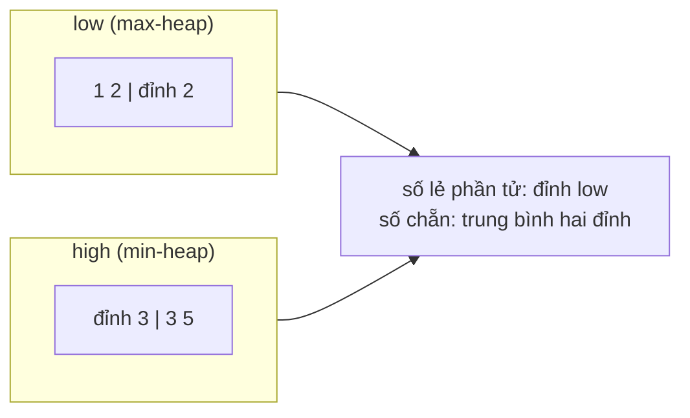

<!-- approaches: Sorted list with binary insertion · Two heaps -->
# 295. Find Median from Data Stream

**Hard** · Two Pointers · Design · Sorting · Heap (Priority Queue) · [LeetCode ↗](https://leetcode.com/problems/find-median-from-data-stream/) · Code: [FindMedianFromDataStream.java](FindMedianFromDataStream.java) · Tests: [FindMedianFromDataStreamTest.java](FindMedianFromDataStreamTest.java)

## Đề bài

Thiết kế `MedianFinder`: `addNum` nhận số từ một **luồng**, `findMedian` trả về **trung vị** của mọi số đã nhận.

```
add 1, add 2 → median 1.5
add 3        → median 2.0
```

## Ý tưởng

> Trung vị chia dữ liệu làm **hai nửa**. Giữ hai heap:
> - `low` — **max-heap** chứa nửa **nhỏ**, đỉnh là số lớn nhất của nửa nhỏ;
> - `high` — **min-heap** chứa nửa **lớn**, đỉnh là số nhỏ nhất của nửa lớn.
> Luôn giữ `|low| = |high|` hoặc `|low| = |high| + 1`. Trung vị nằm ngay ở **đỉnh** hai heap.



**Thêm một số (3 bước, luôn đúng):**
1. đẩy vào `low`;
2. chuyển đỉnh của `low` sang `high` (đảm bảo mọi phần tử `low` ≤ mọi phần tử `high`);
3. nếu `high` nhiều hơn `low`, chuyển đỉnh của `high` về `low`.

| thêm | low | high | median |
|---|---|---|---|
| 1 | 1 | | 1 |
| 2 | 1 | 2 | 1.5 |
| 3 | 1 2 | 3 | 2 |

## Cách 1 — Hai heap ⭐

`addNum` `O(log n)`, `findMedian` `O(1)`.

## Cách 2 — Danh sách sắp xếp

Chèn đúng chỗ bằng tìm kiếm nhị phân; dời phần tử tốn `O(n)`.

## Câu hỏi mở rộng

- Mọi số trong `[0, 100]`? → mảng đếm 101 ô, tìm trung vị bằng cách đếm dồn `O(100)`.
- 99% số trong `[0, 100]`? → mảng đếm + hai danh sách cho phần ngoại lai.
- Trung vị của **cửa sổ trượt** → 480 Sliding Window Median (hai heap + xoá trễ).

## Bài liên quan

480 Sliding Window Median · 4 Median of Two Sorted Arrays · 703 Kth Largest Element in a Stream · 502 IPO.
